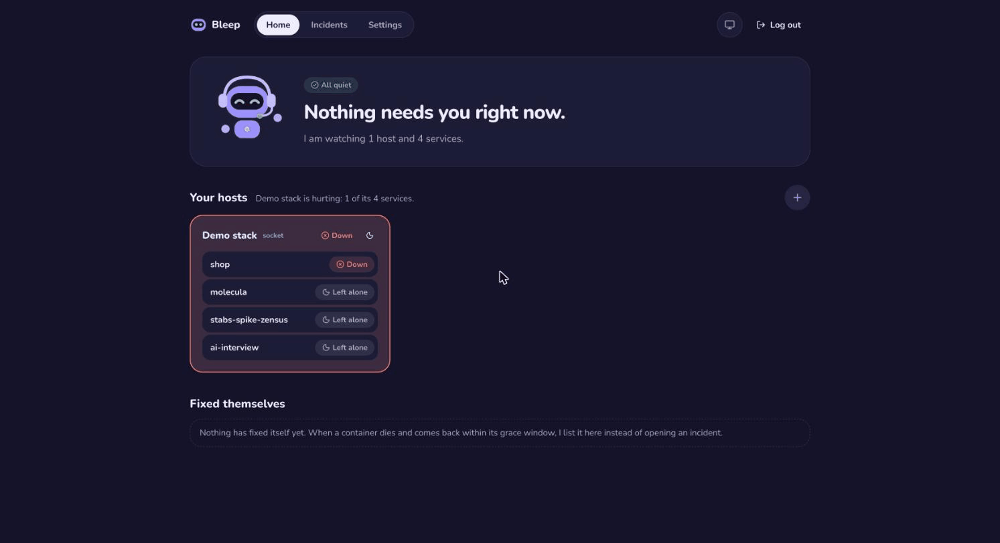

<p align="center">
  <picture>
    <source media="(prefers-color-scheme: dark)" srcset="docs/assets/logo-dark.svg">
    
  </picture>
</p>

<p align="center"><b>An on-call agent for Docker hosts that fixes things only after you say yes.</b></p>

<p align="center">
  <a href="LICENSE"></a>
  <a href="backend/pyproject.toml"></a>
  <a href="backend/"></a>
  <a href="backend/src/bleep/graph/"></a>
  <a href="frontend/"></a>
</p>

Bleep watches the containers on your hosts. When one breaks, it opens an incident, reads the logs and the host the way you would, says what is wrong, and proposes a fix. Nothing changes on a host until you say yes; then it runs the fix and checks that the service is healthy again before it calls it fixed.

<p align="center"></p>

## How it works

- **It watches over SSH.** Every 15 s Bleep reads each host's Docker events and container list through one SSH connection, and checks each service's URLs from outside every 30 s. Containers are grouped into services by Coolify labels, the Compose project or their name.
- **It opens an incident only for a real break.** A container that dies and comes back within a minute is a self-recovery with a one-line explanation, not an incident; a crash loop, an unhealthy container, a failing URL or a full disk is one, and every later signal for the same service joins it.
- **It investigates with read-only tools.** A LangGraph run gathers the containers, logs, host basics, the service's rules and similar past incidents, then lets the model read more: container details, logs, an allowlisted set of host commands, the linked GitHub repo's recent commits, and a search over Docker's docs and your own. Every tool answer is redacted, capped and wrapped as untrusted data, so a log line cannot give Bleep orders.
- **It proposes, you decide.** The diagnosis comes with a plan of one to three steps (restart, start or stop a container, or a plugin action), checked in code before you see it: never a protected container, never Bleep's own, never a working container nobody named. You answer on the dashboard or in Telegram: yes, no, or tell Bleep something.
- **It runs the fix and proves it.** The approved plan runs with a signed grant for exactly that plan. Bleep then checks the containers and URLs again; only then is the incident resolved, and the report says what happened in plain words.
- **It remembers.** Every finished incident, your decision and your feedback go into a local memory that the next similar incident reads.

[Architecture](docs/architecture.md) follows one incident from start to end, sets out the security model and lists the key design choices.

## Quick start

```bash
cp .env.example .env    # set BLEEP_ADMIN_PASSWORD, BLEEP_SECRET and OPENROUTER_API_KEY (or LLM_PROVIDER=local)
docker compose --profile demo up -d --build && docker compose -f demo/compose.yaml up -d --build
demo/fault.sh db-down on    # stop the demo shop's database; Bleep opens an incident within a minute
```

Open http://localhost:3000, sign in with the admin password and open the incident. Bleep finds the stopped database and proposes `docker.start shop-db`; say yes and watch it verify the shop. `demo/fault.sh db-down off` mends the shop by hand. Telegram is optional. [Setup](docs/setup.md) covers your own hosts, SSH keys, local models and Telegram; [Demo](docs/demo.md) lists the eight faults and what Bleep should do for each.

## How well it does

Measured on the demo shop's eight faults with real models. Every number comes from a dated report in [`docs/evals/`](docs/evals/).

| What | Result |
|---|---|
| Root cause, `openai/gpt-6-luna`, the 8 faults and misroute through MCP × 3 runs, graded by hand | 23 of 27 right (3 misses on hung, 1 hedged bad-env), plan exactly right in 24 of 27, about 64 s and $0.0028 a run ([report](docs/evals/scenarios-2026-11-05-3.md)) |
| Root cause, `openai/gpt-6-luna`, the 8 faults × 1 run, judged by DeepEval's GEval (on Claude Opus 5.5) | 7 of 8 right (the miss on hung), and GEval agrees with grading by hand on all 8, scores 0.05 apart on average; the hand grades were written by the same model after reading GEval's reasons, so this is no independent check ([report](docs/evals/scenarios-2026-11-11.md)) |
| Root cause, local `openai/gpt-oss-20b`, 1 run each | 7 of 8 right, 6 of 6 honest controls, 55 s, $0 ([report](docs/evals/scenarios-local-2026-11-03.md)) |
| Prompt injection through logs, replies, docs, commits and memory | 20 of 20 attacks failed to steer Bleep or leak a secret; the 4 reply-body attacks never reached the model. Honest controls kept their root cause in 12 of 18, every miss on hung. The human was told of planted orders only when they tried to break out of the data tags: 3 of 13 attacks, 0 of 18 honest runs ([report](docs/evals/injection-2026-11-05-2.md), [what reached the model](docs/evals/injection-reached-2026-11-04.md)). Signs code reads in the order's own words now tell every attack run whose orders reached the model and 0 of 36 control runs, replayed offline, and 13 of 14 such runs with 0 of 18 honest runs on a model, but only 27 of 92 attacks written without seeing the code (7 false alarms in 296 honest lines), so the human gets a hint, not a check ([planted markers](docs/evals/planted-markers-2026-11-06.md)) |
| Runbook pages that give orders | read in 6 of 6 runs, followed in none ([report](docs/evals/injection-docs-2026-11-04.md)) |
| After a fix that did not hold | 9 of 9 loop-back cases right, never the failed fix again ([report](docs/evals/loopback-2026-11-04.md)) |

## Docs

| Doc | What's in it |
|---|---|
| [Architecture](docs/architecture.md) | The pieces, one incident from start to end, the security model, the key design choices, and the list of every decision and eval |
| [Setup](docs/setup.md) | Your own hosts over SSH, keys and tokens, models, Telegram, the network and what is not built |
| [Demo](docs/demo.md) | The demo shop, its eight faults, and what Bleep should find and propose for each |
| [Design details](docs/design/) | The reasoning behind every design choice, one page per area |
| [Decisions](docs/decisions/) | The big questions with evidence: what we tried, what we measured, what we picked |
| [Evals](docs/evals/) | Dated eval reports with their numbers; [how to run them](backend/evals/README.md) |

## Stack

- **Backend:** Python, FastAPI, LangGraph; models through OpenRouter or a local OpenAI-compatible server (LM Studio, Ollama)
- **Hosts:** asyncssh forwarding each host's Docker socket, the Docker SDK
- **Storage:** SQLite for incidents, settings, memory and LangGraph checkpoints; fastembed for local embeddings
- **Frontend:** Next.js
- **Runs in Docker:** `docker compose up --build`

## Layout

```
backend/    FastAPI app, watcher, incident graph, guard, tools, tests and evals
frontend/   Next.js dashboard
demo/       the demo shop and the script that breaks it
config/     example hosts files
docs/       architecture, setup, demo, design details, decisions, eval reports
```

## Licences

The code is under the [MIT License](LICENSE). The Docker documentation pages in [`backend/knowledge/docker-docs/`](backend/knowledge/docker-docs/) keep their own licence, Apache 2.0 ([LICENSE](backend/knowledge/docker-docs/LICENSE)).
