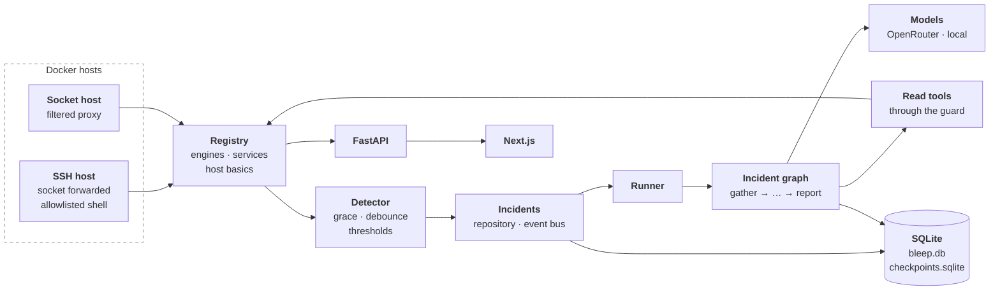

# Architecture

How Bleep is put together, in a few minutes. Each section links to the detail: the reasoning behind every design choice is in `docs/design/`, the big questions with their evidence in `docs/decisions/`.

## The pieces

| Piece | Path | What it does |
|---|---|---|
| **Hosts file** | `config/hosts.example.yaml`, `backend/src/bleep/hosts/config.py` | Which hosts to watch and how to reach them, per-host and per-service rules, URLs and protected containers. Secrets are references to env vars or files, never values. |
| **SSH session and engine** | `hosts/ssh.py`, `hosts/engine.py` | One asyncssh connection per SSH host forwards the remote Docker socket; the `docker` SDK talks to it. A socket host talks to a local endpoint, in the demo a filtered proxy. |
| **Host shell** | `hosts/shell.py` | The read-only command allowlist (exact argv templates) and host basics (disk, memory, load) for Linux and macOS. |
| **Registry** | `hosts/registry.py`, `hosts/discovery.py` | Each host's connection, reachability, containers grouped into services, and basics. |
| **Detector** | `watcher/detector.py` | Pure decision logic: a signal becomes an incident, a self-recovery or nothing (grace window, repeated deaths, debounce, host thresholds). |
| **Incidents** | `incidents/repository.py`, `incidents/bus.py` | Incidents and their signals, one open per subject; the event bus stores every event, then fans it out to live subscribers. |
| **Runner** | `incidents/runner.py` | Runs each incident's graph in the background, resumes it after a decision or a restart, and keeps the incident's status in step. |
| **Incident graph** | `graph/` | LangGraph state, nodes and wiring, checkpointed per incident in `checkpoints.sqlite`. |
| **Read tools** | `tools/` | Docker reads and the host command tool for the model, each scoped to the incident's host. |
| **Guard** | `guard/` | Redacts secrets, strips control characters, caps size and wraps untrusted text before anything reaches a model; checks every proposed plan before a human sees it. |
| **Models** | `llm/` | One factory for OpenRouter and local models, structured output with a plain-JSON fallback, and a token and cost ledger with a daily cap. |
| **Prompts** | `prompts/` | Every prompt is a `.md` file loaded with `prompts.load(name, **vars)`. |
| **Store** | `store/` | SQLite with numbered migrations. |
| **API** | `main.py`, `api/`, `auth/` | Login with one admin password and hashed sessions; the read API over hosts and services. |
| **Dashboard** | `frontend/` | Next.js app: login and an overview of hosts and services, polled every 10 s. |
| **Compose** | `docker-compose.yaml`, `config/socket-proxy.cfg.template` | Runs Bleep; `--profile demo` adds the socket proxy so Bleep can watch this machine. |

Paths under `backend/src/bleep/` are given from there.

## One incident, start to end

| Stage | What happens | Code |
|---|---|---|
| 1. Detect | A container dies, a URL fails or a host crosses a threshold; the detector waits out the grace window and debounces, then asks for an incident. | `watcher/detector.py` |
| 2. Open | The incident is opened, or the signal attaches to the subject's open one. | `IncidentRepo.open_or_attach` |
| 3. Run | The runner starts the incident's graph thread in the background (`thread_id` = incident id). | `IncidentRunner.start` |
| 4. Gather | Containers, the last 200 log lines of the affected ones through the guard, host basics, rules and similar past incidents. No model call. | `graph/nodes/gather.py` |
| 5. Investigate | The model reads with read-only tools, within a budget (placeholder until #17). | `graph/nodes/investigate.py` |
| 6. Diagnose | Root cause, evidence, confidence; low confidence investigates once more, then goes on marked unsure. | `graph/nodes/diagnose.py` |
| 7. Propose | One to three allowlisted actions, or no action with exact instructions for the human; checked in code before anyone is asked, and a refused plan goes back to the model once. | `graph/nodes/propose.py`, `guard/plan_check.py` |
| 8. Approval | The run checkpoints and waits for a yes, a no or an instruction, through a restart if need be. | `graph/nodes/approval.py`, `IncidentRunner.resume` |
| 9. Report | The outcome is set; `resolved` is only ever claimed after verification. | `graph/nodes/report.py` |

Every node publishes `node_started` and `node_finished` on the bus, which stores them for the incident's timeline. On boot, `IncidentRunner.recover_on_boot` resumes every unfinished run except those waiting for approval. The app does not start the runner yet: the watcher manager (#15) connects it to the detector.

## Key design choices

One line each; the full reasoning and issue numbers are on the design page named after each group.

**Hosts** ([details](design/hosts.md))
- **Docker over SSH by forwarding the socket**, so a macOS host whose non-interactive `PATH` lacks `docker` works too ([Docker over SSH](decisions/docker-over-ssh.md)).
- **The demo host goes through a filtered socket proxy**, never a raw socket mount ([socket host](decisions/socket-host.md)).
- **Services are keyed by Coolify labels, else the Compose project, else the container**, and Bleep's own containers (`bleep.self=true`) are left out.
- **Host commands are exact argv templates run without a shell**; anything else is refused by code.

**Watcher** ([details](design/watcher.md))
- **A death that recovers within 60 s is not an incident**; three deaths in ten minutes are.
- **Open at once, attach within the 30 s debounce**, so there is never a second incident for one cause.

**Incidents** ([details](design/incidents.md))
- **One open incident per subject, enforced by a unique index.**
- **An unreachable host absorbs its services' signals.**
- **The bus persists before it fans out**, so the timeline never loses an event.

**Graph** ([details](design/graph.md))
- **One module per node, each owning its routing**; `build.py` only wires them.
- **Gather is deterministic and reads logs through the guard.**
- **One checkpointed thread per incident**, resumed after a restart; runs waiting for a human stay waiting.
- **The checkpoint serializer rebuilds only the state's own models.**

**Agent and models** ([details](design/agent.md))
- **One model factory for OpenRouter and local models**; structured output falls back to plain JSON for weak models.
- **A cost ledger with a daily cap** stops a runaway incident before the next call.

**Guard** ([details](design/guard.md))
- **All host text is redacted, cleaned, capped at 8,000 characters and wrapped as untrusted data with a random id.**
- **Env values never reach the model.**
- **Every plan is checked in code**: allowlisted, enabled actions on the incident's host only, never a protected or Bleep container, at most 3 steps.

**App** ([details](design/app.md))
- **One admin password and hashed session tokens in an HttpOnly cookie.**
- **The dashboard reaches the API through a Next.js rewrite**, so the cookie stays same-origin.

## Decisions

| Question | Answer |
|---|---|
| [Docker over SSH](decisions/docker-over-ssh.md) | Forward the remote socket through one asyncssh connection per host. |
| [Socket host](decisions/socket-host.md) | A filtered proxy with four rules, not a raw socket mount. |
