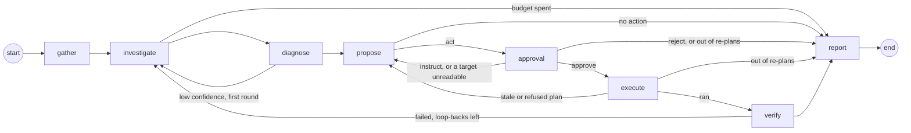

# Graph

How one incident is worked: the LangGraph state, the nodes in order, where the loops go, and how a run survives a restart (`backend/src/bleep/graph/`, `backend/src/bleep/incidents/runner.py`).

## Node order

| Node | Does | Routes on |
|---|---|---|
| `gather` | Collects containers, recent logs, host basics, rules, similar past incidents and the service's facts ([memory](memory.md)). No model. | always to `investigate` |
| `investigate` | The model reads with read-only tools, at most 8 tool calls a round; every result reaches it through the guard. | `outcome == "budget"` → `report`, else `diagnose` |
| `diagnose` | A structured `Diagnosis`. | low confidence after the first round → `investigate`, else `propose` |
| `propose` | A `Proposal`: one to three allowlisted steps, or no action, checked in code (`guard/plan_check.py`) before a human sees it. | `act` → `approval`, `no_action` → `report` |
| `approval` | Snapshots the target containers, stores the plan as a pending approval, notifies, and waits for the human (`interrupt()`). | `approve` → `execute`; `instruct` or a target it could not read → `propose`; `reject`, or no re-plans left → `report` |
| `execute` | Re-reads every target against its snapshot, then runs the approved steps in order through the act tools, each logged `started` before and `done`, `failed` or `skipped` after. | ran → `verify`; stale or refused → `propose`; no re-plans left → `report` |
| `verify` | Waits, then checks the planned containers and URLs. | failed with loop-backs left → `investigate`, else `report` |
| `report` | Sets the outcome, writes the report (the model writes the summary, cause and follow-ups; the rest is code), publishes it, sends it to every channel, remembers it with the human's feedback and keeps the human's lasting instructions as service facts ([memory](memory.md)); the runner closes the incident once the report is checkpointed. | end |

Every node, the topology and the runner are built. An approved plan runs in Execute and is judged by Verify before the report; only Verify's pass makes the outcome `resolved` (#25).

## State

`IncidentState` (`graph/state.py`) is a `TypedDict`; the models it holds are in `schemas/graph.py`.

| Key | Holds | Written by |
|---|---|---|
| `incident_id`, `subject`, `signals` | Which incident, about what, and the signals that opened it | the runner, at start |
| `context` | `GatherContext`: containers, guarded log excerpts, host basics, top memory users (host incidents), host and service rules, similar past incidents and the service's facts (Bleep's memory), `gaps` | `gather` |
| `messages` | The model conversation (`add_messages` reducer) | `investigate`; `diagnose` appends "Missing: ..." for a second round |
| `investigate_rounds`, `tool_calls_used` | Budget counters | `investigate` |
| `diagnosis` | `Diagnosis(root_cause, category, evidence, confidence, affected_services, unsure)` | `diagnose` |
| `proposal`, `instructions` | `Proposal(kind, steps, reason, verification, human_instructions)`; the human's instructions so far | `propose`, `approval` |
| `approval`, `decision`, `grant` | The approval this run last consumed (`ApprovalRequest(id, plan_hash)`); the human's `Decision`; the `ApprovalGrant` act tools check (voided by Execute when the plan is stale) | `approval`, `execute` |
| `replans` | Trips back to Propose from Approval or Execute so far | `approval`, `execute` |
| `executed`, `step_results` | The id of the approval whose plan Execute last ran; what each step of every plan that ran did (`StepResult`), in order; `report` reads it as the action taken | `execute` |
| `verify_loops`, `verification` | Loop-backs from Verify so far; the last `VerificationResult(ok, checks, attempt)` | `verify` |
| `outcome`, `report` | `resolved`, `rejected`, `no_action`, `unverified`, `budget` or `unsure`; the write-up (`Report`) | `report` (or a node that ends the run early) |

## Choices

- **Every Milestone 2 model is defined up front in `schemas/graph.py`.** Milestone 3 filled in the rest: `StepResult` is the act tools' result since #24 ([guard](guard.md#act-tools)), `VerificationResult` and `Check` were filled in by Verify (#26), and `Report` by the Report node (#27). Reason: the node tasks run side by side and each needs the others' shapes fixed (#16).
- **One module per node, owning its `make(deps)` and its `route(state)`.** `graph/build.py` only wires them and lists each route's possible targets. Reason: a node task changes its own module and nothing else (#16).
- **Dependencies are passed once, as `GraphDeps`.** Registry, tool registry, act tools, a model factory (`role → chat model`), memory, bus, approvals, notifier, guard log, settings, the cost ledger and the action log (#24). Nodes are closures over it; the state holds only data. Reason: the state is checkpointed, and a connection or a model client does not belong in a checkpoint (#16).
- **Memory, notifier, approvals and settings are Protocols with small defaults.** `NullMemory` recalls and keeps nothing (the app's memory is `MemoryStore`, #29), `NullNotifier` sends nothing beyond the bus, `InMemoryApprovals` keeps requests in a dict (tests only; the app's store is `ApprovalStore`, #20), `StaticSettings` serves the default budgets, the env's model settings and the three Docker actions. Reason: the graph runs and is tested without long-term memory, Telegram or the settings store (#16).
- **`Approvals.request` takes one `TargetSnapshot` per plan target.** Reason: a plan has up to three steps, and each target must be re-checked before Execute (#16).
- **Gather makes no model call.** It reads through the registry and the engine only; a test fails if the model factory is even asked for a model. Reason: the first look is cheap, repeatable and cannot be steered by the logs it reads (#16).
- **Gather refreshes the host first.** It lists the containers again before reading them. Reason: the incident is about the state now, and the watcher's last poll can be 30 s old (#16).
- **Log excerpts: the last 200 lines of each affected container, through the guard.** Affected means the containers the signals name, or every container of the service when none does (a URL check), at most 5. Each excerpt goes through `guard_text` (redacted, cleaned, capped at 8,000 characters, wrapped as `<untrusted>`), and redactions are recorded in the guard log. Reason: logs are the main way hostile text reaches the model, so they enter the state already safe to put in a prompt (#16).
- **A host incident gets the top 5 containers by memory.** `docker stats` on the running containers, at most 8 at once. Reason: when a host runs out of memory the first question is who is using it (#16).
- **Basics come from the registry, not a new SSH read.** Reason: the registry reads them at most every 60 s already; a second read would double the SSH traffic for no new information (#16).
- **What Gather cannot read becomes a line in `gaps`, never an error.** An unreachable host, a vanished service or a failed recall each add one fixed, short line ("logs of shop-web-1: host unreachable"); engine error text is not copied in. Reason: the run must go on with what it has, and Bleep's own lines must not carry host text (#16).
- **Similar incidents are asked for with `"<service or host>: <signal kinds>"` and the service id, top 3.** Reason: what failed and where is the useful similarity at the start of an incident, and the id lets memory rank the same service first (#16).
- **Every node publishes `node_started` and `node_finished` with `{"node": name}`.** A wrapper in `build.py` does it, so no node can forget. Reason: these events are the live reasoning view (#16).
- **A node that calls `interrupt()` runs again from its first line on resume.** It publishes `node_started` again and no `node_finished` before the pause, and anything it does before `interrupt()` must be safe to repeat. Reason: that is how LangGraph resumes; the approval node is the one this matters for (#16).
- **Checkpoints go to `checkpoints.sqlite` through `AsyncSqliteSaver`, one thread per incident (`thread_id` = incident id).** `open_checkpointer(path)` opens it for the app's lifetime. Reason: a run can wait hours for a human and must outlive a restart (#16).
- **The checkpoint serializer may rebuild only the state's own models.** `checkpoint_types()` walks `IncidentState` for every pydantic model, nested ones included, and passes them to LangGraph's `allowed_msgpack_modules`. Reason: without the list LangGraph rebuilds any class a checkpoint row names, and already warns that it will stop doing so (#16).
- **The runner runs each incident in a background task.** `start(incident)` and `resume(incident_id, decision, approval_id)` return at once; one incident never runs twice at the same time, and a second `start` while one is in flight returns that run. Reason: the watcher and the Telegram poller must not wait for a model (#16).
- **`start` goes on from wherever the thread stands.** No checkpoint: the notifier hears `incident_opened`, then a new run starts from Gather with the incident's signals. A checkpoint mid-graph: on from it. Waiting at approval: stays waiting, unless the approval was decided before a restart (see below), and then goes on with that decision. Finished: not run again; only a terminal status that a crash left unset is settled from the outcome. Reason: starting an incident twice, or after a restart, must never repeat work or lose an answer (#16, #20, #72).
- **`recover_on_boot` restarts every unfinished incident except those `awaiting_approval` whose approval is still pending.** Reason: those are waiting for a human, and their checkpoint holds them until a decision arrives; one whose approval was decided before Bleep stopped is not waiting any more (#16, #20).
- **A decision recorded before a crash is delivered on boot.** When the thread is still at the interrupt but the incident's latest approval is decided (Bleep died after `resolve` and before the resumed run reached a checkpoint, whether the status still says `awaiting_approval` or already `investigating`), the runner resumes it with the stored decision. It reads the store through the `approvals` it is built with. Reason: otherwise the human's answer is lost and the incident waits forever for a question already answered (#20).
- **A decision for a run that is not waiting changes nothing.** It is logged and dropped. Reason: a late or duplicate decision must not restart or fail a finished run (#16).
- **A resume is bound to the approval it answers.** `resume(incident_id, decision, approval_id)` goes on only when the run is waiting at the interrupt for that `approval_id` (the interrupt's value carries it; `waiting_for(incident_id)` reads it); otherwise it is logged and dropped. The dashboard and Telegram pass the id of the plan they showed. Reason: a human can answer a plan while the Approval node is still sending it; the node then finds it decided and goes on without interrupting, and the channel's resume, queued behind that run, would otherwise land on the next plan's interrupt and decide a plan nobody saw (#72).
- **The runner keeps the incident's status in step.** `investigating` while a run is in flight (also after a decision, so a crash then is recovered), `awaiting_approval` at the interrupt, `resolved` when the outcome is `resolved`, else `closed`. Only the runner closes an incident, after the run's last checkpoint is written, so a crash before it leaves the incident open for the boot recovery (#28). A node that raises marks the incident `failed` and publishes a `notice` naming the error type. A status write that fails (the database is locked, the disk is full) is logged at once and handled the same way, and anything else that escapes a run is logged by the runner rather than left in the task for shutdown to find. Reason: the status is what the dashboard and the boot recovery read, and a run that dies silently leaves an incident `investigating` forever (#16, #72).
- **Diagnose is one structured model call, no tools.** It reads Gather's context and the investigation messages and returns a `Diagnosis` through `invoke_structured`, so a model without tool support still answers (#18).
- **Low confidence means `unsure`, and the route reads that flag.** `Diagnosis.unsure` is set when confidence is below the budget's `low_confidence` (0.6 by default, read from settings when the node runs). The first unsure diagnosis, at `investigate_rounds == 1`, goes back to Investigate once; a second one goes on to Propose still unsure, so the proposal can say "I am not sure, here is what I found". Reason: the route has only the state, and the threshold is a setting (#18).
- **The model says what is missing, and that becomes the next round's instruction.** The model fills a private `missing` field next to the diagnosis (not stored on it); Diagnose appends it as a message ("Missing: ...") so Investigate looks for exactly that. Reason: a second round without a target repeats the first (#18).
- **Evidence entries are cut to 300 characters, at most 8.** The prompt asks for statements, and the code truncates what overruns. Reason: weak models paste log lines, and a diagnosis is shown to the human and stored in memory (#18).
- **No diagnosis is a diagnosis, not an error.** Unparseable output (after `invoke_structured`'s retry) or a spent token or cost budget gives `category="unknown"`, `unsure=True`, "I could not form a diagnosis", with the stopped containers and gaps from Gather as evidence. A failed structured reply also gets the one re-investigation, like any low-confidence result. Reason: a weak local model must degrade, not crash the run (#18).
- **Propose asks for a whole plan in one structured answer.** One to three ordered steps or `no_action`, a reason and a verification plan (containers and URLs), through `invoke_structured`, so a model without tool calls answers in plain JSON. Reason: the human approves the plan as a whole, and a weak local model must still be able to answer (#19).
- **Propose's prompt carries Bleep's own facts, not the logs.** The diagnosis with its evidence, the service's containers, the off-limits list (protected and Bleep's own containers), the host and service rules, what Bleep remembers (the similar past incidents with the human's decisions and feedback, and the service's facts), the service's health URLs, the actions enabled right now, every instruction the human has given and the previous plan (`prompts/graph/propose.md`). Reason: the diagnosis already carries the evidence; keeping raw host text out of the step that writes the plan narrows what an injected log line can steer, and naming the off-limits containers spares a refusal round (#19).
- **The memory section is labelled as Bleep's own record, with quoted log text still untrusted, as in Investigate's prompt.** Each past incident is one `describe_past` line and each fact one `describe_fact` line ([memory](memory.md)); the prompt asks the model not to propose again a plan the human rejected for a similar incident unless the diagnosis shows what changed, and to follow the service's facts when an enabled action allows it. Reason: "always redeploy rather than restart" and "the human rejected this restart last time" exist to change the next plan, and before #87 they reached only Investigate and Diagnose, so the plan step heard them only if the model copied them into a diagnosis (M3 review I2, #87).
- **The enabled actions are read from `settings_store` each time Propose runs.** Reason: turning a plugin off must stop its actions on the next plan, not after a restart (#19).
- **A plan the code refuses goes back to the model once; refused again, it becomes `no_action`.** The model sees each violation's text (`prompts/graph/propose_retry.md`); after a second refusal the human gets the reasons, the refused steps and the model's reason in `human_instructions`, and nothing goes to approval. Reason: a model often fixes a plan once it can read why it was refused, and one that does not should not get a third try at a guarded action (#19).
- **An unsure diagnosis still goes to Propose with the model, framed as "I am not sure, here is what I found".** `prompts/graph/propose_unsure.md` adds a section asking for the smallest, most reversible step (or `no_action`) and a reason that starts with "I am not sure" and says what was found. The plan check and the human's approval apply as for any plan. Only a missing diagnosis or a spent budget skips the model call. Reason: the first live run (a killed container with no restart policy) ended in `no_action` although `docker.start` was safe and obvious; the human is the safety, not silence (#75).
- **Diagnose rates confidence in the failure and its remedy, not in who triggered it.** What broke, why the service is down and what would bring it back; a container stopped with exit 137, no OOM kill and no restart policy is a confident diagnosis. Reason: the live run scored 0.45 only because nothing showed who sent the kill, which does not change the remedy (#75).
- **Propose degrades instead of failing.** No usable structured answer gives `no_action`; a spent token budget or daily cap gives `no_action` with the outcome `budget`, checked before each of its (at most two) model calls. Reason: an incident must always end with a report, never a crashed run (#19).
- **The final proposal is published as a `proposal` event.** Reason: the live view shows the plan, or why there is none, as soon as it exists (#19).
- **Investigate runs its model ↔ tools loop inside one node.** It asks the model, runs the calls it makes, hands back the results and asks again, and stops when the model answers without a tool call, after 8 tool calls this round (`Budgets.investigate_tool_calls`), or when a budget is spent. Reason: the topology stays the one `build.py` already wires, and one node owns the whole budget (#17).
- **The tool-call cap ends the round, not the run.** The run goes on to Diagnose with what was found. Calls past the cap in the same reply are answered `not run: the tool-call budget for this round is spent`, because a conversation with an unanswered tool call is refused by the next model call. `tool_calls_used` counts every round together. Reason: eight reads are normally enough to diagnose, and stopping there is cheaper than failing the incident (#17).
- **A spent cost budget stops before the model call.** `check_budget` runs before every call; on `BudgetExceeded` the node sets `outcome = "budget"`, publishes a `notice` naming the daily cap or the incident's token budget, tells the notifier and records `budget` in the guard log, and the route goes to Report. Reason: a daily cap of $0 must mean no model call at all (#17).
- **Every tool result is guarded again in the node, and wrapped exactly once.** A result that is one wrapper already (the Docker and host tools guard their own output) is cleaned and redacted again and rewrapped under the tool's name, without a second cut, so the `[… N chars cut]` count stays true. Anything else (a tool's own short text, `host unreachable: <wrapped error>`, a future tool that does not guard) goes through `guard_text` whole, with any wrapper inside taken off first; output over 32,000 characters skips that step and any wrapper in it is escaped as data, so a hostile result cannot make the pattern scan it many times. Reason: the model never sees a result that skipped the guard, whoever wrote the tool, and never sees a wrapper inside a wrapper (#17).
- **A refusal or a failure is text for the model.** `CommandNotAllowed` comes back as the refusal and is recorded as `refused_command`; any other exception comes back as `the tool failed (<type>)` without its message; an act tool's name is answered as not available and recorded as `blocked_action`; an unknown name is answered `there is no tool named …`. Reason: the model can correct a call it can read about, and one bad call must not end the investigation (#17).
- **Tool calls and results stream to the bus.** `tool_call {name, args}` before the call, `tool_result {name, chars, summary_first_line}` after it, where `chars` is the length the model gets and `summary_first_line` the first non-empty line inside the wrapper (at most 160 characters, already redacted). Reason: the live view shows what the agent is looking at without copying whole logs into the timeline (#17).
- **The first round opens the conversation with `prompts/graph/system.md` and `prompts/graph/investigate.md`.** The system prompt says host text arrives as `<untrusted>`, that only the closing tag with the same id ends it, and that host and service rules apply to every conclusion. The task message carries the subject, the signals and the containers (both wrapped, since signal details and image names come from the host), Gather's log excerpts as they are, the host's basics and top memory users, the rules, similar past incidents, the gaps and the budget. Reason: the system prompt is shared by the nodes that come after, and only Bleep's own text sits outside a wrapper (#17).
- **A second round continues the same conversation.** When Diagnose sends the run back, Investigate adds `prompts/graph/investigate_again.md` with the low-confidence diagnosis, unless the last message is already a human one (Diagnose said what to look for). Reason: the model keeps what it read in the first round, and the second round is about what was missing (#17).

## Approval

`graph/nodes/approval.py`, `incidents/approvals.py` (`ApprovalStore`), `incidents/reminders.py` (`ReminderLoop`), table `approvals` (migration 0006).

- **The first decision wins, enforced by one statement.** `resolve` is a single `UPDATE approvals ... WHERE incident_id = ? AND status = 'pending'`; the caller whose update changed a row won, every other gets None. A partial unique index allows one pending approval per incident. Reason: Telegram and the dashboard can answer at the same moment, and a read-then-write check loses that race. `resolve` also takes the `approval_id` the decision was made for and adds `AND id = ?`, so a late button tap on a replaced plan wins nothing; the node passes its own approval's id, and the channels (#21, #22) pass the id from the button or callback (#20).
- **The plan hash covers the steps and the container ids their targets resolved to.** `plan_hash(proposal, snapshots)` is sha256 over the canonical JSON (sorted keys, no spaces) of each step plus its `container_id` (`null` for a step whose target is not a container). The reason text and the verification plan are not part of it. Reason: a container recreated under the same name is a different target, so an approval for the old one must not cover it (#20).
- **The grant is `HMAC-SHA256(BLEEP_SECRET, incident_id + plan_hash)`, issued only by the store and only for a plan it holds as approved.** `plan_hash` and `grant_token` live in `guard/grant.py` beside `verify_grant`, which the act tools run ([guard](guard.md#act-tools), #24). The node asks `approvals.grant(incident_id)` after an approve; a reject, an instruction or a pending approval gets none. Reason: an act tool can check the grant without the database, and nothing but a recorded yes can mint one (#20).
- **Each Docker target is snapshotted when the question is asked.** `TargetSnapshot(host_id, target, container_id, started_at, restart_count, state)`, read with a fresh `inspect`, one per distinct target, stored with the approval for Execute to compare against. `created` stays empty: the engine's summary does not carry it, and a recreated container already shows as a new id. Reason: Execute must refuse to act on a container that changed since the human said yes (#20).
- **A target that cannot be read sends the run back to Propose instead of asking.** The node publishes a `notice` naming the target and a fixed reason ("container not found", "host unreachable") and stores nothing. Reason: a question about a container that is not there cannot be answered usefully, and Execute would refuse it anyway (#20). It counts as a re-plan (see below), so a run that keeps proposing it ends (#25).
- **The question is asked once per round, even though the node reruns on resume.** The node asks only when the incident's latest approval is the one in `state["approval"]` (already consumed by an earlier round) or there is none; otherwise the latest approval is this round's, asked before a resume or a restart, and is reused without a second `approval_requested` or message. Reason: a node that interrupts runs again from its first line, and a second pending row or a duplicate message would confuse the human (#20).
- **The stored decision is the one that counts.** If the latest approval is already decided when the node runs, it uses that decision and does not interrupt; a value resumed into `interrupt()` is first passed to `resolve`, and if it loses, the winner's decision on that same approval is used; if the store holds none, the node raises `ApprovalNotDecided` and the run fails rather than guess (an explicit check, not an `assert`, so it holds under `python -O`). A notifier that raises does not fail the node: the question is already stored and on the bus, so it logs, publishes a `notice` and still interrupts, and the reminder loop re-sends. Reason: a late or stray resume can never override what the human actually chose first (#20).
- **The node publishes `approval_requested` (`approval_id`, `plan_hash`) and `decision` (`kind`, `text`, `via`), and calls `Notifier.proposal`.** Reason: the bus is the dashboard's timeline; the notifier carries the question to Telegram (#20).
- **An instruction appends its text to `instructions` and goes back to Propose**; a reject goes to Report with the outcome `rejected`; a yes goes to Execute (#25); a `no_action` proposal never reaches Approval (Propose routes it to Report). Reason: §4.4 step 5 (#20).
- **At most `Budgets.replans` (3) trips back to Propose per run, from Approval or Execute.** An instruction, a target Approval cannot read and a plan Execute finds stale or refused each count one (`graph/replan.py`, state key `replans`); one more ends the run with the outcome `replan_limit` ("Stopped after too many new plans") and a `notice` saying so, and the routes go to Report. Verify's loop-back does not count; it has its own budget. Reason: LangGraph's recursion limit is 10,000 steps, so a target that never becomes readable, a container that keeps restarting or an endless exchange of instructions would otherwise loop for hours on model calls (m2 review M1) (#25).
- **Reminders re-send a pending approval every `approval_reminder_min` minutes (60) and never decide it.** The n-th reminder is due n periods after the request; the count is stored, so after downtime one reminder goes out, not one per missed period, and it is counted before it is sent (a crash loses a reminder rather than repeating one). Only approvals of open incidents are reminded. The period is read from the settings at every tick. Reason: a plan can wait days for an answer, and Bleep must never act without an explicit yes (§2, §4.4) (#20).

## Execute

`graph/nodes/execute.py`, `graph/replan.py`.

- **Nothing runs unless the approval is the one this run consumed and it says yes.** The node reads the incident's latest approval from the store and requires its id to be `state["approval"]`'s, its decision `approve` and its proposal the state's. Reason: resume is already bound to the approval the human saw (#72); Execute keeps that binding instead of trusting the state alone (#25).
- **Before the first step every target is read again and compared with its snapshot: the container id and the start time.** A target that is gone, has another id (recreated) or another start time (started again since approval) makes the plan stale, and so does a host that cannot be read. `TargetSnapshot.created` stays empty and is not compared: the engine's summary does not carry it, and a recreated container already has another id. Reason: the human approved an action on the container as it was; one that changed may need another plan (§4.5) (#25).
- **A start time moved together with a higher restart count is not stale.** Docker's restart policy restarts a crash-looping container on its own, about once a minute at most, and each restart moves its start time and raises its restart count. That is the failure the human approved a fix for, so the plan runs. The same id with a moved start time and the same count is a start by hand or by another tool, and stays stale. A snapshot stored before #87 has no count, and then any new start time is stale. Reason: a human rarely answers within a minute, so comparing the start time alone turned every approval for a crash-looping container stale, and the run ended at the re-plan limit with nothing done (M3 review I1, #87).
- **Then every step goes through its act tool's own checks (`ActTool.check`) before any step runs.** The grant is checked with `verify_grant` against the stored plan, and the target with the guard's rules (host error, protected, Bleep's own); an action with no act tool yet (the Coolify ones) is refused. Reason: a plan the guard would refuse at step 2 must not run step 1 (#25).
- **A stale or refused plan runs nothing and goes back to Propose with a `notice` and a voided grant.** "The plan did not run, the state changed since approval: shop-web-1 on a was recreated. Planning again." (or "Bleep's checks refused it: …"). Propose plans again, and Approval asks the human again, for the plan as the world is now. It counts as a re-plan. The decision is cleared with the grant, since the yes was for the plan that did not run: a next plan of "no action" must not report "Approved on …" (#87). A run out of re-plans keeps it, so its report says the human approved and Bleep stopped. Reason: only a human can approve a plan for the changed world (#25).
- **The steps run in order, each logged `started` before its act tool runs and `done` or `failed` after it.** The engine is called with the approved container id (#24). A failed step, or one the act tool refuses at that moment ("refused, nothing ran: …"), stops the plan; every later step is logged `skipped` with the reason and never runs. Then Verify, which judges the service whatever ran. Reason: a later step usually depends on an earlier one, and a partial fix still has to be checked and reported (#25).
- **Each status change is published as an `action` event, `{action, target, status}` with `started`, `done`, `failed` or `skipped`.** The results are appended to `step_results`, one per step, after those of any earlier plan of the run; a result's `started_at` is the time logged before the call. Reason: the report's timeline is built from these events and its "action taken" from `step_results` (#27), and the dashboard's timeline shows each step (#25).
- **A rerun after a crash reads the action log first, and never runs a step twice.** A `done`, `failed` or `skipped` step keeps its logged result. A step left `started` may have reached the engine, so it is re-read on the host, never run again: it counts as `done` ("restarted shop-db-1, confirmed after a restart") when the container is running and started later than the start time in the approval's snapshot (restart, start), or is stopped and finished later than it (stop), and as `failed` ("not confirmed after a restart …; not run again") otherwise, which skips the rest. Both times are the host's, so a host clock ahead of or behind Bleep's does not matter (#87). A step not yet started is compared with its snapshot again before it runs, the start time only when no earlier step of the plan acted on that container; a change skips it and the rest. Reason: Review Focus 1; Verify still judges the service, so a restart that did happen but cannot be confirmed costs a wrong "failed" line, never a second restart (#25).
- **The action log's plan key is the plan hash followed by the approval id (`<hash>:<approval id>`).** Reason: Verify's loop-back can end in the same restart approved again, with the same container id and so the same hash; keyed by the hash alone, the second yes would find the first run's `done` rows and run nothing (#25).
- **The route reads `executed`, the approval whose plan the node ran.** Equal to `state["approval"]`'s id → Verify; otherwise the plan did not run → Propose; an outcome set by the re-plan budget → Report. Reason: a route sees only the state, and "the grant is gone" alone could not tell a stale plan from a plan that ran without one (#25).
- **Limits.** A step left `started` on a crash-looping container cannot be told from the restart policy's own restart: a later start time confirms it either way. Verify then judges the service, and nothing is run twice (#87).

## Verify

- **Waits 20 s, then checks up to 3 times, 10 s apart, and stops at the first check where everything passes.** The waits are `deps.sleep` (default `asyncio.sleep`), so tests inject a clock and never sleep. Reason: a restarted service needs time to come up, and one early failed check should not condemn a fix (#26).
- **A check is ok only when every planned container is running and healthy (or running with no healthcheck) and every planned URL passes `check_url`.** Containers are read live with `inspect`, not from the registry's last poll. A URL the service already configures keeps its expected status and body text; one the model added gets the defaults. Reason: "running" alone is not "fixed" (§2) (#26).
- **An empty verification plan falls back to the service's containers (minus protected ones) and URLs, then to the containers the steps acted on.** With nothing at all to check the outcome is `unverified` at once. Reason: a proposal that forgot to say what to check must not make a fix look verified by checking nothing (#26).
- **A failure with fewer than `Budgets.verify_loops` (2) loop-backs so far goes to Investigate, then `unverified`.** `verify_loops` counts loop-backs, so a stubborn failure is verified three times in all. The loop-back appends `prompts/graph/verify_failed.md` with the failed checks only (Bleep's own one-line details; a URL failure names its kind, never text the server sent), which Investigate reads as the next round's instruction, as with Diagnose's. Success sets the outcome `resolved`; nothing else does. Reason: a second look is cheap, an endless one is not (#26).
- **Each check publishes a `verification` event (`ok`, `attempt`, `checks`); the notifier hears the final result of the round once.** A notifier that raises is logged and does not fail the node. Reason: the live view shows progress; a chat message per check would be noise (#26).

## Report

`graph/nodes/report.py`, `prompts/graph/report.md`, `guard/report_check.py`.

- **The outcome is decided in code before any model writes.** An outcome set earlier stands (a spent budget, Verify's `resolved`, the re-plan budget's `replan_limit`); otherwise a run in which any step started is `unverified` (Verify sent it back and the next plan was rejected or empty: "nothing was done" would be false, #25), a reject is `rejected`, no plan or a `no_action` plan is `no_action`, and an approved plan that nothing verified is `unverified`, never `resolved`. Reason: Bleep never claims "fixed" without verification (§2) (#16, #27).
- **Each outcome has one fixed text:** `resolved` "Fixed and verified", `unverified` "Action taken, not verified", `rejected` "Rejected, nothing was done", `no_action` "No action proposed, nothing was done", `unsure` "Cause not found, nothing was done", `budget` "Stopped, the model budget is spent", `replan_limit` "Stopped after too many new plans" (#25). It is `Report.outcome`. Reason: the line a human reads first must not be model text, and only a verified fix may say "Fixed" (#27).
- **`Report(title, summary, cause, action_taken, outcome, timeline, follow_ups, human_decision)`: the model writes only the summary, the cause and the follow-ups.** The title is the incident's; `action_taken` is one `action target on host: done|failed|skipped` per entry of `step_results` (`skipped` for a step that never started, #25), the host read from the plan step at its `step_index` because `StepResult` names none (None when nothing ran); `human_decision` is the final decision with its channel ("Approved on Telegram", "Rejected on the dashboard", "Instruction from Telegram: …"). Reason: what the run already knows must not depend on a model retelling it (#27).
- **The timeline is built in code from the incident's stored bus events, plus the signals that opened it,** in time order: each signal, "Gathered the context", "Investigated with N tool calls", "Diagnosed", the proposal, "Asked for approval", each reminder, every decision with its channel, each Execute `action` event (`{action, target, status}`, one per step status change), each Verify check ("Check 2 failed") and every notice. Node starts and single tool calls and results are left out. It reads the event history, not `action_log`. Reason: the history already holds every step in order and replays the same after a restart; `action_log` is Execute's crash ledger (#27).
- **The report prompt carries Bleep's record and no log text:** the title, the outcome text, the diagnosis with its evidence, the plan with its reason and any advice to the human, the decision, what ran and the timeline. It tells the model to use the outcome as given and never to write "fixed" unless it is "Fixed and verified". Reason: a model copies what it reads, and the diagnosis already says what the logs meant (#27).
- **What the model writes is cut, then checked in code.** Summary 800 characters, cause 500, at most 5 follow-ups of 300. Unless the outcome is `resolved`, every sentence that says "fixed" is dropped. Then `check_report` replaces anything copied from a log the run read ([guard](guard.md#report-check)). A field left empty falls back to Bleep's record: the summary to "<title>: <outcome>.", the cause to the diagnosis's root cause (or "Not determined."), the follow-ups to the plan's advice to the human. Reason: the prompt asks, code enforces (#27).
- **A model that fails, or a spent budget, gives a report from the record alone.** The budget is checked before the one model call, and any error from the call is logged by type and falls back. Reason: every incident ends with a report, also the one stopped because its budget ran out (#27).
- **The report is published as a `report` event and sent through `Notifier.report` for every outcome, and the node returns `outcome` and `report` into the checkpoint, where the API reads it; the node does not close the incident.** A channel that fails is logged and changes nothing. The runner closes it (`resolved` for `resolved`, else `closed`) once that checkpoint is written. Reason: #27 closed it in the node, and a crash between that close and the checkpoint left a closed incident, which the boot recovery skips, with no report where the API reads it (found by the resume tests, #28). Now a crash anywhere before the checkpoint leaves the incident open, and the next boot runs Report again (a second message) (#27, #28).
- **`step_results` replaced the unused placeholder key `execution`.** Execute (#25) fills it; only Report reads it. Reason: one key for the step results, named as the report reads them (#27).

## Crash-safe resume

`backend/tests/graph/test_resume_e2e.py` kills Bleep at a named point of an incident and finishes it in a new process: the real `IncidentRunner`, graph, `ApprovalStore`, action log and checkpoint file, with a `FakeEngine` host and a scripted model that outlive the crash. Review Focus 1.

| Killed | Next boot | Engine calls in total |
|---|---|---|
| While waiting for approval | Stays waiting; the decision on the new process executes the plan | 1 |
| After the decision was stored, before the resumed run reached a checkpoint (the resume never ran, or died inside Approval) | `recover_on_boot` delivers the stored decision; no second question | 1 |
| After the restart reached the engine, before `done` was written | Execute runs again and confirms the step on the host | 1 |
| After `started`, before the engine call | Execute runs again and reports the step failed, not run again | 0 |
| After `done`, before Execute's checkpoint | Execute runs again and keeps the logged result | 1 |
| During Verify's wait | Verify runs again from its start | 1 |
| After the report went out, before its checkpoint | Report runs again and the runner closes the incident | 1 |
| The same plan approved again after Verify's loop-back, killed after its second restart | The second approval's step is confirmed, not repeated; late answers to either question change nothing | 2 |

- **A process is cut off by cancelling its runner's tasks at a hook that never returns.** The hooks sit inside the engine call, in Verify's wait and in the bus before an event is stored. Reason: a cancelled task writes nothing more, as a killed process does, and each crash point is exact (#28).
- **Each crash point is checked against a broken Bleep too.** Running a `started` step again, ignoring a stored decision, keying the action log by the plan hash alone, or re-running a `done` step with the log's own guard removed each fails at least one of these tests. Reason: tests that pass on the first run must still be shown to catch the failure they name (#28).
