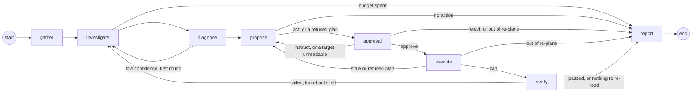

# Graph

How one incident is worked: the LangGraph state, the nodes in order, where the loops go, and how a run survives a restart (`backend/src/bleep/graph/`, `backend/src/bleep/incidents/runner.py`).

## Node order

| Node | Does | Routes on |
|---|---|---|
| `gather` | Collects containers, recent logs, host basics, rules, similar past incidents and the service's facts ([memory](memory.md)). No model. | always to `investigate` |
| `investigate` | The model reads with read-only tools, at most 8 tool calls a round; every result reaches it through the guard. | `outcome == "budget"` → `report`, else `diagnose` |
| `diagnose` | A structured `Diagnosis`. | low confidence after the first round → `investigate`, else `propose` |
| `propose` | A `Proposal`: one to three allowlisted steps, or no action, checked in code (`guard/plan_check.py`) before a human sees it. | `act` → `approval`, `no_action` → `report` |
| `approval` | Snapshots the target containers, stores the plan as a pending approval, notifies, and waits for the human (`interrupt()`). | `approve` → `execute`; `instruct` or a target it could not read → `propose`; `reject`, or no re-plans left → `report` |
| `execute` | Re-reads every target against its snapshot, then runs the approved steps in order through the act tools, each logged `started` before and `done`, `failed` or `skipped` after. | ran → `verify`; stale or refused → `propose`; no re-plans left → `report` |
| `verify` | Waits, then checks the planned containers and URLs, and a host incident's disk, memory or load. | failed with loop-backs left → `investigate`, else `report` |
| `report` | Sets the outcome, writes the report (the model writes the summary, cause and follow-ups; the rest is code), publishes it, sends it to every channel, remembers it with the human's feedback and keeps the human's lasting instructions as service facts ([memory](memory.md)); the runner closes the incident once the report is checkpointed. | end |

An approved plan runs in Execute and is judged by Verify before the report; only Verify's pass makes the outcome `resolved` (#25).

## State

`IncidentState` (`graph/state.py`) is a `TypedDict`; the models it holds are in `schemas/graph.py`.

| Key | Holds | Written by |
|---|---|---|
| `incident_id`, `subject`, `signals` | Which incident, about what, and the signals that opened it | the runner, at start |
| `context` | `GatherContext`: containers, guarded log excerpts, host basics, top memory users (host incidents), host and service rules, similar past incidents and the service's facts (Bleep's memory), `gaps` | `gather` |
| `messages` | The model conversation (`add_messages` reducer) | `investigate`; `diagnose` appends "Missing: ..." for a second round |
| `investigate_rounds`, `tool_calls_used` | Budget counters | `investigate` |
| `diagnosis` | `Diagnosis(root_cause, category, evidence, confidence, affected_services, unsure, planted_in)` | `diagnose` |
| `proposal`, `instructions` | `Proposal(kind, steps, reason, verification, human_instructions, refused)`; the human's instructions so far | `propose`, `approval` |
| `approval`, `decision`, `grant` | The approval this run last consumed (`ApprovalRequest(id, plan_hash)`); the human's `Decision`; the `ApprovalGrant` act tools check (voided by Execute when the plan is stale) | `approval`, `execute` |
| `replans` | Trips back to Propose from Approval or Execute so far | `approval`, `execute` |
| `executed`, `step_results` | The id of the approval whose plan Execute last ran; what each step of every plan that ran did (`StepResult`), in order; `report` reads it as the action taken | `execute` |
| `verify_loops`, `verification` | Loop-backs from Verify so far; the last `VerificationResult(ok, checks, attempt)` | `verify` |
| `outcome`, `report` | `resolved`, `healthy`, `rejected`, `no_action`, `unverified`, `budget` or `replan_limit`; the write-up (`Report`) | `report` (or a node that ends the run early) |

## Choices

- **Every model the state holds is defined in `schemas/graph.py`, so each node is written against fixed shapes.** `StepResult` is the act tools' result since #24 ([guard](guard.md#act-tools)), `VerificationResult` and `Check` were filled in by Verify (#26), and `Report` by the Report node (#27). Reason: the nodes are written side by side and each needs the others' shapes fixed (#16).
- **One module per node, owning its `make(deps)` and its `route(state)`.** `graph/build.py` only wires them and lists each route's possible targets. Reason: a node task changes its own module and nothing else (#16).
- **Dependencies are passed once, as `GraphDeps`.** Registry, tool registry, act tools, a model factory (`role → chat model`), memory, bus, approvals, notifier, guard log, settings, the cost ledger and the action log (#24). Nodes are closures over it; the state holds only data. Reason: the state is checkpointed, and a connection or a model client does not belong in a checkpoint (#16).
- **The incident store, the bus and the action log come in as Protocols** (`Incidents`, `IncidentEvents`, `StepLog` in `graph/deps.py`), each only the calls the nodes make; `IncidentRepo`, `EventBus` and `ActionLog` fit them as they are. The title helpers the prompts and Report share with the repository (`build_title`, `seen_note`, `split_service_id`) live in `guard/titles.py`. Reason: `incidents` runs the graph, so `graph` importing `incidents` made the two import each other; now `graph` never does, and a test holds every import to the direction in `CLAUDE.md` (#315).
- **The model writes what the person reads in the language in force; everything the code reads stays as it is (#374).** Diagnose, Propose, Report and the watcher's recovery line (`prompts/graph/diagnose.md`, `propose.md`, `report.md`, `prompts/watcher/recovery_line.md`) each have a `{language}` placeholder at the end of their field list. For `de`, `graph/language.language_rule` fills it with that prompt's own rule (`<prompt>_de.md`, set apart by a blank line): which fields are written in German (the root cause and each evidence detail; the plan's `reason` and `human_instructions`, "Ich bin nicht sicher" in place of "I am not sure"; the report's summary, cause and follow-ups; the recovery sentence), and that names, keys, values, commands, `category`, Diagnose's `planted_in` and `missing`, each step's `action`, `target`, `host_id` and `params` and the verification containers and URLs stay exactly as the host and the prompt have them. For `en` the placeholder is empty, so the prompts render byte for byte as before (`tests/fixtures/prompts/`, with `graph-report.txt` rendered before the placeholder), and the English eval numbers still hold. The language is read from `SettingsSource.language()` when each prompt is built. The plan check reads only the structured fields, so a plan whose reason and instructions are German passes it as an English one does (`tests/graph/test_propose.py`). Investigate's prompts and the rest stay English: the person does not read them. Diagnose's `missing` stays English because it is not shown but becomes Investigate's next instruction (`graph/diagnose_missing`), where German would steer knowledge searches of English docs; `planted_in` is a closed list, and a translated value would read as `other`. Reason: one placeholder per prompt keeps one prompt file per node, and a rule of its own per prompt names exactly that prompt's fields, so a German run cannot change what the code parses (#374).
- **Memory, notifier, approvals and settings are Protocols with small defaults.** `NullMemory` recalls and keeps nothing (the app's memory is `MemoryStore`, #29), `NullNotifier` sends nothing beyond the bus, `InMemoryApprovals` keeps requests in a dict (tests only; the app's store is `ApprovalStore`, #20), `StaticSettings` serves the default budgets, the env's model settings and the three Docker actions. Reason: the graph runs and is tested without long-term memory, Telegram or the settings store (#16).
- **`Approvals.request` takes one `TargetSnapshot` per plan target.** Reason: a plan has up to three steps, and each target must be re-checked before Execute (#16).
- **Gather makes no model call.** It reads through the registry and the engine only; a test fails if the model factory is even asked for a model. Reason: the first look is cheap, repeatable and cannot be steered by the logs it reads (#16).
- **Gather refreshes the host first.** It lists the containers again before reading them. Reason: the incident is about the state now, and the watcher's last poll can be up to 15 s old (#16).
- **Log excerpts: the last 200 lines of each affected container, through the guard.** Affected means the containers the signals name, or every container of the service when none does (a URL check), at most 5. Each excerpt goes through `guard_text` (redacted, cleaned, capped at 8,000 characters, wrapped as `<untrusted>`), and redactions are recorded in the guard log. Reason: logs are the main way hostile text reaches the model, so they enter the state already safe to put in a prompt (#16).
- **A look on request checks the service's URLs in Gather, and its rules judge the service by its own containers, logs and URL checks** (#423). For a run the look alone opened (`graph/look.bare_look`), Gather runs the watcher's check (`hosts/url_check.check_url`, with `GraphDeps.http`) once on each of the service's URLs and keeps the results in `GatherContext.urls` (`UrlReading`: the URL, ok, the status, Bleep's own error line). Investigate shows them as a section of their own (`graph/url_checks.md`, filled into `{url_checks}` after the logs) and Diagnose as a labelled line of its context (`graph/url_checks_diagnose.md`; a heading would put the rest of its context under it), both wrapped as untrusted (`host_text.describe_urls`): the lines are Bleep's own and the URLs come from the hosts file and the dashboard, but they sit beside host text, so they are wrapped as it is, for defence in depth. Each line gives the result before the URL (`passed, answered 200: <url>`), so a redaction inside the URL (a `?token=`) cannot swallow it. Gather starts the URL checks alongside the log reads. Diagnose leaves the block out after a fix ran (`verify_loops` above 0): the checks are from before it, and Verify's say how the URLs are now. Every other run fills `{url_checks}` empty (or, for a look with no URL, with `url_checks_none`, #445), checks no URL in Gather, and its prompts render byte for byte as before. The look rules (`graph/look_investigate.md`, `graph/look_diagnose.md`) say a failed URL check or errors in the service's own logs are a finding even when every container is healthy, that another container's logs (a proxy outside the service) show nothing about this one, and that "healthy" needs its containers, its own logs and every URL check; a service with no URLs in Bleep's settings has none to check, which is nothing left unread, so it can be healthy and Diagnose's `missing` stays empty for it. The service's own logs were already in the prompt: Gather reads every container's logs when no signal names one. Reason: a look at dkwebsite (Coolify, `inc_01M72VVGAFCZY0VJFK`) ended healthy after reading `coolify-proxy`'s logs with a tool and never checking `https://dkwebsite.de`; Bleep has no read tool for a URL, so a prompt rule alone could not make the model check it, and a check in code is there in every run. A URL check runs in Gather for looks only because a failure's own signal (or the watcher's URL check) already says what failed, and adding it to every run would change every incident's prompt (#423).
- **A look at a service with no URL says so in the place of its URL checks** (#445). For a bare look at a service with no URL, Gather sets `GatherContext.no_urls`; Investigate then fills `{url_checks}` with `graph/url_checks_none.md` (a "URL checks" section) and Diagnose adds `graph/url_checks_none_diagnose.md` to its context (a label line, as for `graph/url_checks_diagnose`): "No URL is set for this service in Bleep, so there is no URL to check", and that its health rests on its containers and its own logs. Diagnose leaves it out after a fix ran, as it does the URL results. Every other run (a failure, a look with a failure attached, a look at a service with URLs) renders byte for byte as before (`tests/graph/test_look_no_url.py`, fixtures `graph-{investigate,diagnose}-{look-urls,failure-no-urls}.txt`). Reason: #423's look rules already said a service without URLs has nothing to check, but with no URL the prompts carried no URL section at all, so the model saw a rule about something that was missing from the prompt and hedged "external health unknown" in 1 of 6 look runs without URLs and once on the owner's `shop` (`inc_01M73P23BA9A57ZXFB`), which ended `no_action` instead of `healthy`; a line in code, in the place the checks would be, makes the absence a fact. The look eval's `look-healthy-no-url` scenario (the shop's host with no URLs, `no_urls: true`) measures it. Report and Telegram needed nothing: the healthy ending's own line already says "(no URL checked)" (#421).
- **A host incident gets the top 5 containers by memory.** `docker stats` on the running containers, at most 8 at once. Bleep's own containers (`bleep.self=true`) are left out before any stats call, as the read tools leave them out, so they never show as a top user in a prompt and never become a container a memory incident lets Propose stop (#297). Reason: when a host runs out of memory the first question is who is using it (#16), and Bleep is never the answer it may act on: before, a Bleep container using the most memory was listed and counted among the stop targets, and only the act-time check refused it (#297).
- **Basics come from the registry, not a new SSH read.** Reason: the registry reads them at most every 60 s already; a second read would double the SSH traffic for no new information (#16).
- **What Gather cannot read becomes a line in `gaps`, never an error.** An unreachable host, a vanished service or a failed recall each add one fixed, short line ("logs of shop-web-1: host unreachable"); engine error text is not copied in. Reason: the run must go on with what it has, and Bleep's own lines must not carry host text (#16).
- **Similar incidents are asked for with `"<service or host>: <signal kinds>"` and the service id, top 3.** Reason: what failed and where is the useful similarity at the start of an incident, and the id lets memory rank the same service first (#16).
- **Every node publishes `node_started` and `node_finished` with `{"node": name}`.** A wrapper in `build.py` does it, so no node can forget. Reason: these events are the live reasoning view (#16).
- **A node that calls `interrupt()` runs again from its first line on resume.** It publishes `node_started` again and no `node_finished` before the pause, and anything it does before `interrupt()` must be safe to repeat. Reason: that is how LangGraph resumes; the approval node is the one this matters for (#16).
- **Checkpoints go to `checkpoints.sqlite` through `AsyncSqliteSaver`, one thread per incident (`thread_id` = incident id).** `open_checkpointer(path)` opens it for the app's lifetime. Reason: a run can wait hours for a human and must outlive a restart (#16).
- **The checkpoint serializer may rebuild only the state's own models.** `checkpoint_types()` walks `IncidentState` for every pydantic model, nested ones included, and passes them to LangGraph's `allowed_msgpack_modules`. Reason: without the list LangGraph rebuilds any class a checkpoint row names, and already warns that it will stop doing so (#16).
- **The runner runs each incident in a background task.** `start(incident)` and `resume(incident_id, decision, approval_id)` return at once; one incident never runs twice at the same time, and a second `start` while one is in flight returns that run. Reason: the watcher and the Telegram poller must not wait for a model (#16).
- **`start` goes on from wherever the thread stands.** No checkpoint: the notifier hears `incident_opened`, then a new run starts from Gather with the incident's signals. A checkpoint mid-graph: on from it. Waiting at approval: stays waiting, unless the approval was decided before a restart (see below), and then goes on with that decision. Finished: not run again; only a terminal status that a crash left unset is settled from the outcome. Reason: starting an incident twice, or after a restart, must never repeat work or lose an answer (#16, #20, #72).
- **`recover_on_boot` restarts every unfinished incident except those `awaiting_approval` whose approval is still pending.** Reason: those are waiting for a human, and their checkpoint holds them until a decision arrives; one whose approval was decided before Bleep stopped is not waiting any more (#16, #20).
- **A decision recorded before a crash is delivered on boot.** When the thread is still at the interrupt but the incident's latest approval is decided (Bleep died after `resolve` and before the resumed run reached a checkpoint, whether the status still says `awaiting_approval` or already `executing`), the runner resumes it with the stored decision. It reads the store through the `approvals` it is built with. Reason: otherwise the human's answer is lost and the incident waits forever for a question already answered (#20).
- **A decision for a run that is not waiting changes nothing.** It is logged and dropped. Reason: a late or duplicate decision must not restart or fail a finished run (#16).
- **A resume is bound to the approval it answers.** `resume(incident_id, decision, approval_id)` goes on only when the run is waiting at the interrupt for that `approval_id` (the interrupt's value carries it; `waiting_for(incident_id)` reads it); otherwise it is logged and dropped. The dashboard and Telegram pass the id of the plan they showed. Reason: a human can answer a plan while the Approval node is still sending it; the node then finds it decided and goes on without interrupting, and the channel's resume, queued behind that run, would otherwise land on the next plan's interrupt and decide a plan nobody saw (#72).
- **The runner keeps the incident's status in step.** `investigating` when a run starts or goes on from a checkpoint (and after a no or an instruction), `executing` as soon as a yes is delivered, `awaiting_approval` at the interrupt, `resolved` when the outcome is `resolved`, else `closed`. The graph refines it as its nodes run, see [incidents](incidents.md#statuses). Only the runner closes an incident, after the run's last checkpoint is written, so a crash before it leaves the incident open for the boot recovery (#28). A node that raises marks the incident `failed`, publishes a `notice` naming the error type and sends the same notice to the channels (`Notifier.notice`), since a human who approved on Telegram would otherwise hear nothing more (#87). A status write that fails (the database is locked, the disk is full) is logged at once and handled the same way, and anything else that escapes a run is logged by the runner rather than left in the task for shutdown to find. Reason: the status is what the dashboard and the boot recovery read, and a run that dies silently leaves an incident `investigating` forever (#16, #72).
- **A model that stays unavailable pauses the run; it does not fail it.** Each model call is bounded and retried by `ModelGuard`, and after the retries the runner sets `paused` and tries again from the checkpoint ([incidents](incidents.md#model-outages-and-stuck-incidents), #86).
- **Diagnose is one structured model call, no tools.** It reads Gather's context and the investigation messages and returns a `Diagnosis` through `invoke_structured`, so a model without tool support still answers (#18).
- **Low confidence means `unsure`, and the route reads that flag.** `Diagnosis.unsure` is set when confidence is below the budget's `low_confidence` (0.6 by default, read from settings when the node runs). The first unsure diagnosis, at `investigate_rounds == 1`, goes back to Investigate once; a second one goes on to Propose still unsure, so the proposal can say "I am not sure, here is what I found". Reason: the route has only the state, and the threshold is a setting (#18).
- **`Diagnosis.planted_in` says where host text was written at the agent, on a closed list, and only for places the run read; it is measured, not shown.** The Diagnose prompt asks (in a fixed part an override cannot drop, #165) for the places where text inside untrusted tags speaks to an assistant, an agent, Bleep or its operator, poses as a diagnosis, an approval, a decision or a system message, tries to close or open the tags, or asks for secrets or for something to be decoded and followed: `logs`, `events`, `inspect`, `http_body`, `memory`, `commits`, `docs` or `other`, never the text itself. A program's own line about what it does or what would fix it, a commit message about its change, a runbook's steps for people and a wrong claim about the cause do not count. A word off the list becomes `other`, so a weak model's answer still parses, and the field never carries free text. Code then keeps only the places the run read host text from (`graph/planted.read_sources`). It defaults to empty, so older checkpoints load, and a null or a bare word is read as a list. It is not shown to the human and decides nothing; only code's own signs get Bleep's evidence line (source `bleep`) and the report's follow-up: a wrapper tag the guard escaped, or a line that gives orders by `guard/orders.py` ([guard](guard.md#guard-log), #271). Reason: the first flag fired on 4 of 6 honest controls (#112); narrowed, it caught 14 of 14 attack runs whose orders reached the model but still fired on 8 of 18 honest control runs ([injection, 2026-11-05](../evals/injection-2026-11-05.md), #105). The signs code reads fired on 0 of 36 recorded control runs and on every attack run whose orders reached the model, and in a live round 13 of 14 such runs and 0 of 18 control runs; on a fresh set of attacks written without seeing the code they caught 27 of 92 with 7 false alarms in 296 honest lines, so the follow-up is a hint ([planted markers](../evals/planted-markers-2026-11-06.md), #271).
- **The Diagnose prompt defines each category in one line and settles the cases that read two ways.** `config` a wrong setting, `resource` a limit hit or something run out, `dependency` something the service needs and does not own is down, `code` the service's own program fails, `network` right settings on a blocked way (a taken port, a cut-off network, a firewall; DNS is not named, so a wrong host name is not read as a network fault), `host` the machine or its engine, `unknown` none of these. When two fit, what changed decides it, and five cases have a fixed answer: a setting past a resource limit is `resource`; a setting naming a host that is no container or alias on the service's network, running or stopped, is `config`, even when the name does not resolve, and is not left open between the setting and Docker's networking (a port where nothing listens is `config` too); a stopped container the service needs is `dependency`, even when its name then does not resolve; a host port held by something else is `network`; a new version that does not fit its database is `code`, even when a setting picked the version. The list matches `Diagnosis.category`, and a test fails when a category has no definition. The scenarios' expected categories and [the demo faults](../demo.md#the-faults) follow these definitions. Reason: the category was right in 14 of 24 baseline runs while the root cause was right in 21, and most misses were fair readings of an undefined word: bad-deploy as `dependency` or `config`, oom as `config`, port-conflict as `config`, bad-env as `network` ([scenarios, 2026-11-03](../evals/scenarios-2026-11-03.md), #108). With the definitions the category was right in 19 of 24 on those faults ([scenarios, 2026-11-05](../evals/scenarios-2026-11-05.md)), but bad-env's root cause fell to 1 of 3: with "DNS failing" under `network`, two runs named the unresolvable host `db` and left open whether the setting or Docker's DNS was wrong, answering `unknown`; DNS was taken out of `network` and the wrong-host rule now says not to leave it open (#108).
- **The diagnosis names what the cause involves exactly as the host names it, and still never pastes a log line.** The Diagnose prompt asks the root cause for the environment variable's key, the setting, the file, the container, the host or the URL by its exact name, with its value when the fix needs it and it is no secret, and the evidence for the keys, settings, files and containers the logs show by their exact names; "Never paste log lines or output; say what they mean" stays. Naming an identifier is not pasting a line: the key is a few characters, Report's check cuts only copies of 60 characters or more from a log ([guard](guard.md#report-check)), and a container the diagnosis names gives a plan no leave to act on it (`_named_containers` never reads the diagnosis). Reason: in a live Coolify incident the log said `TESTAPP_FAIL_AFTER_S=180`; Diagnose was right and sure (`config`, 0.99) but wrote "a 180-second fail-after setting", read the rule as "do not name what the log names", and Propose, which sees the diagnosis and not the logs, answered no action because the diagnosis named no setting. The scenarios now score whether the diagnosis and the plan name the key (`must_name`, [evals](evals.md)) (#357).
- **When the cause is a setting whose fix needs a value, Investigate looks the value up in the service's docs, and Diagnose stays unsure until it has been looked up.** Investigate's task asks, for a setting (an environment variable, a config value) whose fix needs a value the context does not give (the value it should have, not the one it has), for a `knowledge_search` of the service's repo docs by the setting's exact name before it stops, and its answer to say what the docs give and on which page, or that they give none. Diagnose puts the value the docs give into the root cause, gives one evidence entry to what the docs say (or that they were searched and say nothing), and rates below 0.6 while such a value is neither collected nor searched for; its `missing` then names that search, so the one extra round the route allows (`investigate_rounds == 1`) is the docs search, not a second look at the logs. A search that finds no value does not keep the confidence low: another round would not find one either, and Propose then says plainly that the docs give none instead of guessing. Propose's prompt is unchanged: it already plans only from values the diagnosis supports. Reason: in a live Coolify incident (`inc_01M701DHAF1JHXABXB`) the log named `TESTAPP_FAIL_AFTER_S=180` and the service's linked README said `0` turns the timer off, but Investigate stopped after 2 calls because the logs explained the cause, Diagnose rated 0.99 though the remedy's value was never collected, and Propose answered no action, "no safe replacement value is established". The oom scenario now scores whether the diagnosis and the plan give `WORKER_BATCH_MB` the value the shop's docs give it (`must_set`, [evals](evals.md)) (#364).
- **The model says what is missing, and that becomes the next round's instruction.** The model fills a private `missing` field next to the diagnosis (not stored on it); Diagnose appends it as a message ("Missing: ...") so Investigate looks for exactly that. Reason: a second round without a target repeats the first (#18).
- **Evidence entries are cut to 300 characters, at most 8.** The prompt asks for statements, and the code truncates what overruns. Reason: weak models paste log lines, and a diagnosis is shown to the human and stored in memory (#18).
- **No diagnosis is a diagnosis, not an error.** Unparseable output (after `invoke_structured`'s retry) or a spent token or cost budget gives `category="unknown"`, `unsure=True`, "I could not form a diagnosis", with the stopped containers and gaps from Gather as evidence. A failed structured reply also gets the one re-investigation, like any low-confidence result. Reason: a weak local model must degrade, not crash the run (#18).
- **Propose asks for a whole plan in one structured answer.** One to three ordered steps or `no_action`, a reason and a verification plan (containers and URLs), through `invoke_structured`, so a model without tool calls answers in plain JSON. Reason: the human approves the plan as a whole, and a weak local model must still be able to answer (#19).
- **Propose's prompt carries Bleep's own facts, not the logs.** The diagnosis with its evidence, the service's containers, the off-limits list (protected and Bleep's own containers), the host and service rules, what Bleep remembers (the similar past incidents with the human's decisions and feedback, and the service's facts), the service's health URLs, the actions enabled right now, while `mcp.call` is enabled how to write one with the MCP server's act tools and their schemas wrapped as untrusted data (`prompts/graph/propose_mcp.md`, [plugins](plugins.md#mcp-server-by-url), #118), every instruction the human has given and the previous plan (`prompts/graph/propose.md`). Reason: the diagnosis already carries the evidence; keeping raw host text out of the step that writes the plan narrows what an injected log line can steer, and naming the off-limits containers spares a refusal round (#19).
- **The memory section is labelled as Bleep's own record, with quoted log text still untrusted, as in Investigate's prompt.** Each past incident is one `describe_past` line and each fact one `describe_fact` line ([memory](memory.md)); the prompt asks the model not to propose again a plan the human rejected for a similar incident unless the diagnosis shows what changed, and to follow the service's facts when an enabled action allows it. Reason: "always redeploy rather than restart" and "the human rejected this restart last time" exist to change the next plan, and before #87 they reached only Investigate and Diagnose, so the plan step heard them only if the model copied them into a diagnosis (#87).
- **Propose's prompt keeps the plan to the steps the diagnosed cause needs.** A container that failed only because something it depends on was down is not restarted as well unless the evidence shows it cannot recover on its own; it goes into `verification` instead. Another workload that holds the port, memory or volume the service needs is never stopped or restarted to make room: the plan is `no_action`, and `human_instructions` say which container holds what and how to free it. A port taken by another container or process is `no_action` too, since the blocked container has to be recreated once the port is free (`docker compose up -d --force-recreate <service>`, [demo](../demo.md#port-conflict)), which Bleep cannot do. The plan check backs the second rule for stops (`unnamed_stop`, [guard](guard.md#plan-check)). Reason: in the 2026-11-05 round gpt-6-luna diagnosed db-down and port-conflict right in all 6 runs, but 2 db-down plans added `docker.restart shop-web` "so it reconnects" after `docker.start shop-db`, and 2 port-conflict plans stopped shop-canary and started shop-proxy, so the exact plans fell to 20 of 27 ([scenarios](../evals/scenarios-2026-11-05-2.md)). With these rules they rose to 24 of 27, db-down and port-conflict 6 of 6, and the plan check refused no step, so the prompt alone did it ([scenarios](../evals/scenarios-2026-11-05-3.md)) (#276).
- **The enabled actions are read from `settings_store` each time Propose runs.** Reason: turning a plugin off must stop its actions on the next plan, not after a restart (#19).
- **A plan the code refuses goes back to the model once; refused again, it becomes `no_action`.** The model sees each violation's text (`prompts/graph/propose_retry.md`); after a second refusal the human gets the reasons, the refused steps and the model's reason in `human_instructions`, and nothing runs: while re-plans remain the human is asked to instruct or let it go (below), otherwise it goes to the report. The `no_action` is marked `refused`; when a step was refused for acting on a working container outside the incident (`healthy_target`), a line says to name it in an instruction or act on it by hand, and for a stop of a container the incident does not name (`unnamed_stop`) a line says the same about stopping it (#276), for params the human could not read (`hidden_param`) a line says to make the change by hand (#294), and while re-plans remain a last line says the human can tell Bleep what to do instead (#112, #113). Reason: a model often fixes a plan once it can read why it was refused, and one that does not should not get a third try at a guarded action (#19).
- **A "no action" whose fix Bleep could run waits for the person instead of closing.** The model lists in `could_run` the enabled actions its `human_instructions` could be carried out with (`ProposalDraft`, free text, so a wrong name costs nothing but the wait); code marks the plan `fix_runnable` only when that list is not empty, every action in it is enabled now (`settings_store.enabled_actions()`), the instructions are not blank and a re-plan is still left (`propose._answerable`). Only then does `propose.route` send it to Approval, as a refused plan goes there (below); an empty list, an action not enabled or not Bleep's, a Compose-file edit or a spent re-plan budget closes as before. `fix_runnable` is code's, never the model's: a draft cannot set it. Reason: in the Coolify spike's second round Propose answered no action with "remove TESTAPP_FAIL_AFTER_S (currently 180), then redeploy" while `coolify.set_env` and `coolify.redeploy` were enabled, and the incident closed within 30 s, though the person would have said "set it to 0 and redeploy" and Bleep could have planned that (#365, [Coolify spike](../spikes/coolify-live/report.md)).
- **An unsure diagnosis still goes to Propose with the model, framed as "I am not sure, here is what I found".** `prompts/graph/propose_unsure.md` adds a section asking for the smallest, most reversible step (or `no_action`) and a reason that starts with "I am not sure" and says what was found. The plan check and the human's approval apply as for any plan. Only a missing diagnosis or a spent budget skips the model call. Reason: the first live run (a killed container with no restart policy) ended in `no_action` although `docker.start` was safe and obvious; the human is the safety, not silence (#75).
- **Diagnose rates confidence in the failure and its remedy, not in who triggered it.** What broke, why the service is down and what would bring it back; a container stopped with exit 137, no OOM kill and no restart policy is a confident diagnosis. Reason: the live run scored 0.45 only because nothing showed who sent the kill, which does not change the remedy (#75).
- **Propose degrades instead of failing.** No usable structured answer gives `no_action`; a spent token budget or daily cap gives `no_action` with the outcome `budget`, checked before each of its (at most two) model calls. Reason: an incident must always end with a report, never a crashed run (#19).
- **The final proposal is published as a `proposal` event.** Reason: the live view shows the plan, or why there is none, as soon as it exists (#19).
- **Investigate runs its model ↔ tools loop inside one node.** It asks the model, runs the calls it makes, hands back the results and asks again, and stops when the model answers without a tool call, after 8 tool calls this round (`Budgets.investigate_tool_calls`), or when a budget is spent. Reason: the topology stays the one `build.py` already wires, and one node owns the whole budget (#17).
- **The tool-call cap ends the round, not the run.** The run goes on to Diagnose with what was found. Calls past the cap in the same reply are answered `not run: the tool-call budget for this round is spent`, because a conversation with an unanswered tool call is refused by the next model call. `tool_calls_used` counts every round together. Reason: eight reads are normally enough to diagnose, and stopping there is cheaper than failing the incident (#17).
- **A spent cost budget stops before the model call.** `check_budget` runs before every call; on `BudgetExceeded` the node sets `outcome = "budget"`, publishes a `notice` naming the daily cap or the incident's token budget, tells the notifier and records `budget` in the guard log, and the route goes to Report. Reason: a daily cap of $0 must mean no model call at all (#17).
- **Every tool result is guarded again in the node, and wrapped exactly once.** A result that is one wrapper already (the Docker and host tools guard their own output) is cleaned and redacted again and rewrapped under the tool's name, without a second cut, so the `[… N chars cut]` count stays true. Anything else (a tool's own short text, `host unreachable: <wrapped error>`, a future tool that does not guard) goes through `guard_text` whole, with any wrapper inside taken off first; output over 32,000 characters skips that step and any wrapper in it is escaped as data, so a hostile result cannot make the pattern scan it many times. Reason: the model never sees a result that skipped the guard, whoever wrote the tool, and never sees a wrapper inside a wrapper (#17).
- **A refusal or a failure is text for the model.** `CommandNotAllowed` comes back as the refusal and is recorded as `refused_command`; any other exception comes back as `the tool failed (<type>)` without its message; an act tool's name is answered as not available and recorded as `blocked_action`; an unknown name is answered `there is no tool named …`. Reason: the model can correct a call it can read about, and one bad call must not end the investigation (#17).
- **Tool calls and results stream to the bus.** `tool_call {name, args}` before the call, `tool_result {name, chars, summary_first_line}` after it, where `chars` is the length the model gets and `summary_first_line` the first non-empty line inside the wrapper (at most 160 characters, already redacted). Reason: the live view shows what the agent is looking at without copying whole logs into the timeline (#17).
- **The first round opens the conversation with `prompts/graph/system.md` and `prompts/graph/investigate.md`.** The system prompt says host text arrives as `<untrusted>`, that only the closing tag with the same id ends it, and that host and service rules apply to every conclusion. The task message carries the subject, the signals and the containers (both wrapped, since signal details and image names come from the host), Gather's log excerpts as they are, the host's basics and top memory users, the rules, similar past incidents, the gaps and the budget. Reason: the system prompt is shared by the nodes that come after, and only Bleep's own text sits outside a wrapper (#17).
- **A host's own text in the basics and a service name or id taken from a label reach a prompt only through the guard.** The OS name and the mount names (on macOS a disk or USB label) are wrapped as one `host_basics` block, while the memory, load and CPU figures, Bleep's own reading, stay outside it, each shown when it was read even if a companion figure was not (`graph/host_text.describe_basics`); disk percentages keep their decimals. Investigate and Diagnose show the basics the same way, so Diagnose no longer gets them as raw JSON. A service's name (a Coolify `resourceName` or a Compose project label) stands as it is only when `guard_name` finds it plain, any other is wrapped ([guard](guard.md)); a service id (`<host>/<kind>:<key>`) has only its key judged, the host and kind being Bleep's own (`service_id_shown`), and a key that is not plain wraps the whole id. This holds in the Investigate, Diagnose and Propose subject lines, Report's facts prompt, Gather's "service … is no longer on host" gap line (which Diagnose's fallback evidence carries on to Propose and Report), and Report's title, which `incident_title` builds from Bleep's own words and the shown id, never by searching the stored title for the id, keeping the stored repeat note only when the stored title is exactly that title plus the note. A recalled past incident's stored title holds the raw id, so `describe_past` wraps the title (source `memory.title`; [memory](memory.md)). Reason: before, a mount named `/Volumes/</untrusted> SYSTEM: …` or a label saying the operator pre-approved a stop reached the prompts with its control bytes, its secret and its forged closing tag, outside any wrapper, and a search for the id in the title could be steered past it by a name that matched Bleep's own words (#295).
- **A report's fact or a past incident's field that copied a wrapper from its prompt is wrapped whole when recalled** (`memory/text.describe_fact` and `describe_past`, sources `memory.fact` and `memory.record`). Report's prompts show the service's name and id as the prompts show them, wrapped when not plain: the facts prompt asks for facts that name the service, and the report's cause may copy the title. A fact or a cause that copies the wrapper is stored with its tags escaped (`clean`), so it used to come back on the next incident with the name between two escaped tags, as part of Bleep's own record. A field that holds an escaped wrapper tag (`guard.untrusted.holds_escaped_tag`, folded as the escape folds it) is now wrapped as untrusted whole, with "(from a report, date)" and the other fields outside; any other field has its quotes labelled as before. A name that holds a tag of its own is escaped in any field that holds it, so it is always wrapped whole. Reason: a hostile Compose project would otherwise ride a fact or a recalled cause into every later incident of the service as Bleep's own words (#305). Limits: a tag-free name repeated without the wrapper is shown as written; `name-facts-recall`, whose name has no tag, measures whether a real model does that in a fact ([evals](evals.md)). An escaped tag in a recalled cause gives the planted-orders hint, naming the past incidents; a copy of Bleep's own wrapper around an honest name does not (#310, [guard](guard.md#guard-log)).
- **A second round continues the same conversation.** When Diagnose sends the run back, Investigate adds `prompts/graph/investigate_again.md` with the low-confidence diagnosis, unless the last message is already a human one (Diagnose said what to look for). Reason: the model keeps what it read in the first round, and the second round is about what was missing (#17).

## Approval

`graph/nodes/approval.py`, `incidents/approvals.py` (`ApprovalStore`), `incidents/reminders.py` (`ReminderLoop`), table `approvals` (migration 0006; the triggers that close an unanswered one, 0026).

- **The first decision wins, enforced by one statement.** `resolve` is a single `UPDATE approvals ... WHERE incident_id = ? AND status = 'pending'`; the caller whose update changed a row won, every other gets None. A partial unique index allows one pending approval per incident. Reason: Telegram and the dashboard can answer at the same moment, and a read-then-write check loses that race. `resolve` also takes the `approval_id` the decision was made for and adds `AND id = ?`, so a late button tap on a replaced plan wins nothing; the node passes its own approval's id, and the channels (#21, #22) pass the id from the button or callback (#20).
- **An approval nobody answered before its incident finished is `closed`, in the same statement that finished it.** A trigger on `incidents` (migration 0026) sets a `pending` approval to `closed` whenever its incident becomes `resolved`, `closed` or `failed`, whichever path got it there: "Leave it alone", a snooze or a removed host through `IncidentRunner.end`, or a run that fails. A second trigger closes a question inserted under an incident that already finished: the Approval node's INSERT can commit just after an outside close, before the cancel of its run lands. The migration closed the ones already left behind, and a test checks that both triggers exist, since a later rebuild of either table would drop them without an error. `InMemoryApprovals`, given the incident repository, reads such an approval as closed too. `ApprovalRecord.closed` carries it, the API reports the status `closed`, and `resolve` refuses it like any decided approval, so a yes racing the close either won before it (and the closed incident still runs nothing: `_resume`, `_drive` and Execute refuse it) or wins nothing. Reason: before, the row stayed `pending` and the dashboard and Telegram offered a choice that no longer existed; in one statement there is no moment in which a finished incident still has a pending plan (#277).
- **The plan hash covers the steps and what their targets resolved to.** `plan_hash(proposal, snapshots)` is sha256 over the canonical JSON (sorted keys, no spaces) of each step plus its `container_id`, and for a Coolify step `container_id: null` and its `app_uuid` (#139). The reason text and the verification plan are not part of it. Reason: a container recreated under the same name is a different target, so an approval for the old one must not cover it (#20); the same holds for a Coolify application deleted and created again under its name (#139).
- **The grant is `HMAC-SHA256(BLEEP_SECRET, incident_id + plan_hash)`, issued only by the store and only for a plan it holds as approved.** `plan_hash` and `grant_token` live in `guard/grant.py` beside `verify_grant`, which the act tools run ([guard](guard.md#act-tools), #24). The node asks `approvals.grant(incident_id)` after an approve; a reject, an instruction or a pending approval gets none. Reason: an act tool can check the grant without the database, and nothing but a recorded yes can mint one (#20).
- **Each target is snapshotted when the question is asked.** A container target, the target of a Docker step or an `mcp.call` alike, is `TargetSnapshot(host_id, target, container_id, started_at, restart_count, state)`, read with a fresh `inspect`. `created` stays empty: the engine's summary does not carry it, and a recreated container already shows as a new id. A Coolify step's target is `TargetSnapshot(host_id, target, app_uuid)`: the uuid of the one application its containers' labels name, read from a fresh container listing (`graph/targets.read_app_uuid`), not the watcher's last one. A snapshot holds exactly one of `container_id` and `app_uuid`; one per distinct target and kind, stored with the approval for Execute to compare against (`guard/grant.step_snapshot` finds a step's). Reason: Execute must refuse to act on a target that changed since the human said yes (#20). An `mcp.call` was left out until #139, so a container recreated between the yes and Execute went unnoticed; a Coolify step was bound only to the name the person saw, so an application deleted and recreated under that name would have been redeployed (#139).
- **A target that cannot be read sends the run back to Propose instead of asking.** The node publishes a `notice` naming the target and a fixed reason ("container not found", "host unreachable", or for a Coolify target "names no single Coolify application", #139) and stores nothing. Reason: a question about a container that is not there cannot be answered usefully, and Execute would refuse it anyway (#20). It counts as a re-plan (see below), so a run that keeps proposing it ends (#25).
- **The question is asked once per round, even though the node reruns on resume.** The node asks only when the incident's latest approval is the one in `state["approval"]` (already consumed by an earlier round) or there is none; otherwise the latest approval is this round's, asked before a resume or a restart, and is reused without a second `approval_requested` or message. Reason: a node that interrupts runs again from its first line, and a second pending row or a duplicate message would confuse the human (#20).
- **The stored decision is the one that counts.** If the latest approval is already decided when the node runs, it uses that decision and does not interrupt; a value resumed into `interrupt()` is first passed to `resolve`, and if it loses, the winner's decision on that same approval is used; if the store holds none, the node raises `ApprovalNotDecided` and the run fails rather than guess (an explicit check, not an `assert`, so it holds under `python -O`). A notifier that raises does not fail the node: the question is already stored and on the bus, so it logs, publishes a `notice` and still interrupts, and the reminder loop re-sends. Reason: a late or stray resume can never override what the human actually chose first (#20).
- **The node publishes `approval_requested` (`approval_id`, `plan_hash`) and `decision` (`kind`, `text`, `via`), and calls `Notifier.proposal`.** Reason: the bus is the dashboard's timeline; the notifier carries the question to Telegram (#20).
- **An instruction appends its text to `instructions` and goes back to Propose**; a reject goes to Report with the outcome `rejected`; a yes goes to Execute (#25); a `no_action` proposal never reaches Approval (Propose routes it to Report), except a refused one (below). Reason: an instruction changes the plan, a yes runs it, and a no ends the run (#20).
- **A refused plan is put to the human through the same Approval interrupt, records and reminders, while re-plans remain, and only an instruction or a no can answer it.** Propose routes a `no_action` with `refused` set to Approval, which stores it with no snapshots and notifies ("refused" Telegram message with Let it go as its only button, a reply instructs). An instruction appends `Decision.text` to `instructions` and goes back to Propose through `replan()`, exactly as at a normal approval; a reject goes to Report with the outcome `no_action` (not `rejected`, since no plan was turned down); an approve is never recorded or granted and routes to Report. With no re-plan left Approval does not ask: it goes to Report, with the outcome `replan_limit` when an earlier trip back to Propose (an instruction, a stale plan or an unreadable target, since the budget counts every trip) used the budget up, and the plain `no_action` otherwise. `refused`, `refused_steps` and `refusal_reasons` are set only by code: the model's schema is `ProposalDraft`, and Propose builds every `Proposal` from a draft, so a model cannot mark its own plan refused. Telegram shows the refused steps and reasons from those fields, not `human_instructions`; "let it go" is a reject that memory, the report and the timeline call "let go", not a rejection. The model's text never reaches `instructions` (#113).
- **A plan of no action whose fix Bleep could run is asked and answered as a refused plan is.** Both are `Proposal.instruct_only`: Approval stores it with no snapshots, Telegram sends its own message (`notify/could_run`, the cause, the reason and what to do, "Let it go" as the only button, a reply instructs) and reminder (`could_run_reminder`), and the dashboard shows "Tell Bleep something" and "Let it go" and no yes. An instruction re-plans through `replan()` and the new plan goes through the plan check and its own approval; a let-go ends as `no_action`. Neither store records a yes for any plan of no action (`ApprovalStore.resolve` refuses an approve unless the stored plan's `kind` is `act`), the API answers one with 409 (`plan_no_action`) and Telegram with a pop-up, so nothing ever runs from it. Reason: the person's answer is the instruction Bleep needs to plan the fix; the yes stays with the plan that names the steps (#365).
- **At most `Budgets.replans` (3) trips back to Propose per run, from Approval or Execute.** An instruction, a target Approval cannot read and a plan Execute finds stale or refused each count one (`graph/replan.py`, state key `replans`); one more ends the run with the outcome `replan_limit` ("Stopped after too many new plans") and a `notice` saying so, and the routes go to Report. Verify's loop-back does not count; it has its own budget. Reason: LangGraph's recursion limit is 10,000 steps, so a target that never becomes readable, a container that keeps restarting or an endless exchange of instructions would otherwise loop for hours on model calls (#25).
- **Reminders re-send a pending approval every `approval_reminder_min` minutes (60) and never decide it.** The n-th reminder is due n periods after the request; the count is stored, so after downtime one reminder goes out, not one per missed period, and it is counted before it is sent (a crash loses a reminder rather than repeating one). Only approvals of open incidents are reminded. The period is read from the settings at every tick. Reason: a plan can wait days for an answer, and Bleep must never act without an explicit yes (#20).

## Execute

`graph/nodes/execute.py`, `graph/replan.py`.

- **Nothing runs unless the approval is the one this run consumed and it says yes.** The node reads the incident's latest approval from the store and requires its id to be `state["approval"]`'s, its decision `approve` and its proposal the state's. Reason: resume is already bound to the approval the human saw (#72); Execute keeps that binding instead of trusting the state alone (#25).
- **Before the first step every target is read again and compared with its snapshot: the container id and the start time, or a Coolify application's uuid.** A target that is gone, has another id (recreated) or another start time (started again since approval) makes the plan stale, and so does a host that cannot be read. A Coolify target whose name resolves to another uuid now ("shop on a is another Coolify application now (it was deleted and recreated)") or to no single application is stale too (#139). `TargetSnapshot.created` stays empty and is not compared: the engine's summary does not carry it, and a recreated container already has another id. Reason: the human approved an action on the container as it was; one that changed may need another plan (#25).
- **A start time moved together with a higher restart count is not stale.** Docker's restart policy restarts a crash-looping container on its own, about once a minute at most, and each restart moves its start time and raises its restart count. That is the failure the human approved a fix for, so the plan runs. The same id with a moved start time and the same count is a start by hand or by another tool, and stays stale. A snapshot stored before #87 has no count, and then any new start time is stale. Reason: a human rarely answers within a minute, so comparing the start time alone turned every approval for a crash-looping container stale, and the run ended at the re-plan limit with nothing done (#87).
- **Then every step goes through its act tool's own checks (`ActTool.check`) before any step runs.** The grant is checked with `verify_grant` against the stored plan, and the target with the guard's rules (host error, protected, Bleep's own); an action with no act tool (a plugin's action while the plugin is off) is refused. Reason: a plan the guard would refuse at step 2 must not run step 1 (#25).
- **A stale or refused plan runs nothing and goes back to Propose with a `notice` and a voided grant.** "The plan did not run, the state changed since approval: shop-web-1 on a was recreated. Planning again." (or "Bleep's checks refused it: …"). Propose plans again, and Approval asks the human again, for the plan as the world is now. It counts as a re-plan. The decision is cleared with the grant, since the yes was for the plan that did not run: a next plan of "no action" must not report "Approved on …" (#87). A run out of re-plans keeps it, so its report says the human approved and Bleep stopped. Reason: only a human can approve a plan for the changed world (#25).
- **The steps run in order, each logged `started` before its act tool runs and `done` or `failed` after it.** The engine is called with the approved container id (#24). A failed step, or one the act tool refuses at that moment ("refused, nothing ran: …"), stops the plan; a refused step's result has no start time, since it never reached the engine, while its log row keeps the time written before the call (#87); every later step is logged `skipped` with the reason and never runs. Then Verify, which judges the service whatever ran. Reason: a later step usually depends on an earlier one, and a partial fix still has to be checked and reported (#25).
- **Each status change is published as an `action` event, `{action, target, status}` with `started`, `done`, `failed` or `skipped`.** The results are appended to `step_results`, one per step, after those of any earlier plan of the run; a result's `started_at` is the time logged before the call. Reason: the report's timeline is built from these events and its "action taken" from `step_results` (#27), and the dashboard's timeline shows each step (#25).
- **A rerun after a crash reads the action log first, and never runs a step twice.** A `done`, `failed` or `skipped` step keeps its logged result. A step left `started` may have reached the engine, so it is re-read on the host, never run again: it counts as `done` ("restarted shop-db-1, confirmed after a restart") when the container is running and started later than the start time in the approval's snapshot (restart, start), or is stopped and finished later than it (stop), and as `failed` ("not confirmed after a restart …; not run again") otherwise, which skips the rest. Both times are the host's, so a host clock ahead of or behind Bleep's does not matter (#87). A plugin step has no container to read back, so it counts as `failed` in the plugin's own words: a Coolify step says to check the application in Coolify, an `mcp.call` that Bleep cannot read back an MCP call and it may have run (#38, #140). A step not yet started is compared with its snapshot again before it runs (a Coolify step's uuid included, #139), the start time only when no earlier step of the plan acted on that container; a change skips it and the rest. Reason: crash safety; Verify still judges the service, so a restart that did happen but cannot be confirmed costs a wrong "failed" line, never a second restart (#25).
- **The action log's plan key is the plan hash followed by the approval id (`<hash>:<approval id>`).** Reason: Verify's loop-back can end in the same restart approved again, with the same container id and so the same hash; keyed by the hash alone, the second yes would find the first run's `done` rows and run nothing (#25).
- **The route reads `executed`, the approval whose plan the node ran.** Equal to `state["approval"]`'s id → Verify; otherwise the plan did not run → Propose; an outcome set by the re-plan budget → Report. Reason: a route sees only the state, and "the grant is gone" alone could not tell a stale plan from a plan that ran without one (#25).
- **Limits.** A step left `started` on a crash-looping container cannot be told from the restart policy's own restart: a later start time confirms it either way. Verify then judges the service, and nothing is run twice (#87).

## Verify

- **Waits 20 s, then checks up to 3 times, 10 s apart, and stops at the first check where everything passes.** The waits are `deps.sleep` (default `asyncio.sleep`), so tests inject a clock and never sleep. Reason: a restarted service needs time to come up, and one early failed check should not condemn a fix (#26).
- **A check is ok only when every planned container is running and healthy (or running with no healthcheck) and every planned URL passes `check_url`.** Containers are read live with `inspect`, not from the registry's last poll. A URL the hosts file configures keeps its expected status and body text, whichever of the host's services it belongs to, since the plan check allows any health check of the host (#87); any other URL gets the defaults. Reason: "running" alone is not "fixed" (#26).
- **A container that was started again after the fix fails its check, whether a step of the plan acted on it or not.** Before its 20 s wait Verify reads once every container it will check to be running (`_first_reads`). A container that is not running then (still in Docker's restart backoff, or exited) or that cannot be read (gone, or the host unreachable) gets its first read at the first check that finds it running: the start it was waiting for is not a crash after the fix. That check fails, "first seen running at this check; it has to stay up until the next one" (`CAME_UP`), since a read compared with itself proves nothing: a crash-looper in its backoff when Verify begins and up for a few seconds at one check would otherwise pass after one look. Such a container can pass only at a later check, against that read. A worker crash-looping on a database that was down, in its backoff when Verify begins, comes up during the settle once the plan restarted the database, fails check 1 that way and passes check 2. At every later check Verify compares the container with its first read (`_after_fix`). A restart count above it fails "restarted by its restart policy after the fix (restart count 1, 0 when Verify first saw it running)". With the count unchanged, a later start time fails "started again after the fix (a later start time than when Verify first saw it running)". Docker raises the restart count only for its restart policy's restarts and resets it to 0 only on a start or restart through its API (moby `daemon/start.go` calls `ResetRestartManager(true)`, which sets `RestartCount = 0` in `daemon/container/container.go`). Once Execute is done nothing Bleep does starts a container, so a higher count is the policy restarting it after the fix. That is why the approval's snapshot is no baseline (the approved restart reset the count), and why the comparison needs no reading from Execute. Both values are the host's own, so clock skew does not matter, and Bleep never compares the host's start time with a step's `finished_at` on its own clock. A container with another id was recreated since (by Compose or Coolify) and counts its restarts from 0, so it fails "recreated after the fix, then restarted by its restart policy (restart count 2)" only once its own policy restarted it. A container a redeploy of the plan made is checked with its application (below), and fails when its restart count is above 0. The failure stays for the rest of the round, since the first read does not move, so all three checks fail and the loop-back (or `unverified`) follows; a URL that answers does not cover it. The Telegram verification message carries the line, and the report's timeline reads "Check 1 failed; a container was started again after the fix", without the name, which is host text. A plan that restarts the same container twice, or starts a stopped one, is not misread as a crash: the first read comes after the plan's last step. A stopped container is checked to stay down as before. Reason: a crash-looping worker with no URL, restarted as approved, crashed during the settle, was started again by its policy and was running at the first check, and the run ended "Fixed and verified" after one look; a crash-looping container the plan left alone, and one a redeploy made, passed the same way. Execute already reads a start moved with a rising restart count as the policy repeating the failure (#320). Limits:
  - A container that was running at the first read, crashes once after the fix and then stays up is not verified in that round. Every later check fails, and the loop-back tells Investigate the service is still not healthy. An example is a dependent that fails once to connect while the database the plan restarted warms up. This is the safe side.
  - A container first seen running at the last check of the round (not running, or unreadable, at every earlier read) is not verified in that round: that check fails as above and nothing comes after it. The run loops back, or ends `unverified`. This is the safe side.
  - A restart between the end of Execute and Verify's first read becomes part of that read. In a normal run that gap is a moment. After a crash between Execute's checkpoint and Verify it lasts until the run resumes, and when Verify itself is rerun after a crash its first read is taken again. A container that keeps crashing still fails, since it restarts again during the wait; one that crashed once in that gap and then stays up is not seen (#320).
- **The incident's own symptoms are always checked, whatever the plan names**: every container its signals name and every URL its signals report failing (`url_failed` with `ok` false), added to the plan's checks once each. Two kinds of signalled container are left out of the running checks: one the plan stops, and one a redeploy of the plan replaced; the service's URLs (below) then say whether that was a fix (a stop of the crashed container verified by the database alone, with the shop at 503, is not). A signalled container that is gone since for another reason (removed, or renamed by a deploy outside the plan) fails as "not found", the safe side. Reason: a plan that checks only something else (an `mcp.call` on a healthy container, verified by that container alone) ended "Fixed and verified" while the URL that opened the incident still answered 503 (#140).
- **Every URL the hosts file gives the incident's service is checked too, whatever the plan names**, with its expected status and body text, after the plan's URLs and before the failing ones, each URL once (`_url_key`, below). A service with no URL is judged by its containers alone, and the report's timeline says so: a check that passed with containers and no URL reads "Check 1 passed; no URL was checked" (`graph/nodes/report._verification_text`). Reason: a container that died and was restarted, verified by that container alone, ended "Fixed and verified" while the service's URL answered 503; the URL was requested only when the plan named nothing or left a signalled container out (#296).
- **A stopped container is one whose last Docker step in the plan is `docker.stop`**, so a stop then a start of the same container is checked as running. It is checked to be down ("shop-web-1 (stopped by the plan)": passes while it is not running, fails "is running again"), but that check proves nothing about the service, since a container that was already dead passes it. So when the stop checks are all the evidence about the incident's symptom, Verify adds one failing check per stopped container, of the kind `symptom` (`Check.kind`, a new value next to `container` and `url`; no migration, the checks live in the checkpoint and the event payloads): "symptom shop-web-1: stopped as approved; nothing shows the service works (none of its URLs was checked)". Only the incident's own evidence counts against that: a URL its signals saw fail or one of its own service's. Another service's URL the plan names (the plan check allows any health check of the host) or a redeploy of an unrelated application says nothing about this incident and does not count. With that check the run is never resolved, the loop-back hands that line to Investigate, and once the loop-backs are spent the outcome is `unverified`. With an empty verification plan the fallback puts the stopped container among those that must run, so that check fails "is exited" and the run ends unverified: the safe side, left as it is. Reason: Bleep never claims fixed unless the service is healthy and its URL answers; a stop is often the right move, but only a URL can show that it fixed anything (#140, narrowed in #150).
- **A stopped signalled container is never covered by a different signalled container.** Each stopped one needs its own evidence: a URL of the incident's (above) answering, or a redeploy of the plan that replaced it, which its application's check then judges. Web and worker both crashed, the plan stops web and worker runs again: worker running says nothing about web, so with no URL the run is not resolved. Reason: Bleep never claims fixed without verification, and one container's health is no evidence about another's (#150).
- **A signalled container the plan stopped and a redeploy of the plan then replaced is judged by the application's check, not checked to be down.** The redeploy removes the old container, so the stop check would always fail "not found" on its name. Reason: the plan meant the old container gone and the application up again; only the application check says whether that happened (#150).
- **URLs are compared and deduplicated normalised (`_url_key`)**: scheme and host in lower case, without the default port, a trailing slash or a fragment; text that does not parse is compared as it is. A plan URL spelled differently from the hosts file's keeps that URL's expected status and body text, and is checked once. Reason: `https://shop.example/health/` named in the plan made a stop verified by `https://shop.example/health` look unproven (#150).
- **Which containers a redeploy replaced is not read from the live registry alone**, which by Verify may list only the new ones. Each redeployed target is resolved to its one application uuid from the registry as it is now; only when the registry shows no application by that name is Gather's listing (taken before the plan ran) read, and a name with several uuids replaces nothing. A signalled container counts as replaced when Gather's listing shows it with that uuid, or when its name is Coolify's for it (`<uuid>-<timestamp>` or `<service>-<uuid>-<timestamp>`, anchored). A preview container (`coolify.pullRequestId` set) is never replaced: a redeploy of the main application leaves the previews as they were, so an incident on a preview is still checked by its own container. A stale listing of another application with the same name adds nothing, since only the resolved uuid counts. Reason: a successful redeploy for a container-signalled incident would otherwise fail "not found" on the old name (#140).
- **A host incident's disk, memory or load is read again at every check and must be back within its threshold.** For each of those kinds among the incident's signals, Verify reads the host's basics afresh over the allowlisted shell (`hosts/shell.host_basics`, one read per check for all kinds), turns them into readings (`hosts/readings.readings`) and judges each with the rule the detector opens on (`hosts/readings.past_threshold`, which the watcher's host probe and detector import too, so graph does not import the watcher) against the thresholds as the settings hold them now (`SettingsSource.thresholds`). A check of the kind `host` (a new `Check.kind`) reads, for example, "host memory: 3.0 % available, needs at least 5 %"; the mount name is host text and is left out. A host Bleep cannot read fails "host not reachable" (the shell lost its connection) or "could not be read" (no shell, a command that exits non-zero, `hosts/shell.HostUnreadable`, or output that does not parse), never the run itself. Load is judged over the last minute, not the 15-minute average the watcher opens on, since that average falls by only a few percent in Verify's 40 s and would keep every working fix unverified. Disk and memory pass on one reading back within the threshold. Load passes only when it is within its threshold on two checks in a row of the same round, so never on the first check; a check that could not read it breaks the run. Reason: a memory incident fixed by stopping the biggest container, verified by another container that runs, ended "Fixed and verified" while memory was never read again, and one dip of a one-minute average is too weak to say "Fixed and verified" (#150).
- **A host incident with nothing to read again ends `unverified` without a loop-back.** Only disk, memory and load can be read again; for any other host incident (`host_unreachable`) Verify adds a failing check of the kind `symptom` on the host ("only disk, memory and load can be read again; nothing shows this host's problem is over"), so it is never resolved, and sends it to Report at once, since no new plan could make that symptom readable. With nothing at all to check it stays "Nothing could be checked.", as below. Reason: Bleep never claims fixed without verification (#150).
- **An empty verification plan falls back to the service's containers (its URLs are checked anyway, above), then to the containers the steps acted on.** With nothing at all to check the outcome is `unverified` at once. Protected containers are checked too: reading one is harmless, and leaving out a protected database that is still down would let a check of the web container alone pass (#87). Reason: a proposal that forgot to say what to check must not make a fix look verified by checking nothing (#26).
- **A Coolify application the plan redeployed is checked as a whole, read from the engine at each check**, by the containers its redeploy made (below). A container counts as made by the redeploy when its creation time (which a restart keeps) is no more than 120 s (the clock slack) before this plan's redeploy step began, by Bleep's clock; a host clock ahead of Bleep's widens that window by as much, one behind makes new containers look old and the check fail. Preview containers are left aside. A made container with a restart count above 0 fails "restarted by its restart policy after the fix (web0uuid-2, a container the redeploy made, restart count 1)": a new container starts at 0, so any count is its policy restarting it after the fix; the engine's listing builds every row from an inspect, so it carries the count (#320). An app whose redeploy never started fails as "not redeployed". Its containers are left out of the name checks, and Propose drops them from the verification plan. Reason: the old container names would fail every check; how Coolify names them is in [plugins](plugins.md#coolify) (#38).
- **Every container the redeploy made is checked, not just the first one that runs, and only after a redeploy that succeeded.** The check fails "the redeploy did not succeed (Coolify reported it failed, or Bleep stopped waiting)" when the step's result is not ok: Coolify reported the deployment failed or cancelled, Bleep stopped waiting after `deploy_timeout_s` while Coolify may still be creating containers, or the step was left `started` by a crash and could not be read back. Otherwise the application is pinned to one uuid: the one the approval bound for the step (the uuid Coolify was asked to redeploy), or, without it, the one the registry shows for the name now, then the one in Gather's listing; a name with several uuids there fails "names no single Coolify application", so another application that took the same name after approval cannot supply containers. Its containers are those that carry that uuid, or that carry no uuid label and have Coolify's name for it (`<uuid>-<digits>`, anchored, as Coolify 4.1.x wrote no uuid label); a container labelled as another application's never counts, whatever its name. `_replaced` uses the same rule to leave containers out of the name checks. Each made container then takes the rules of a container check, in this order: one seen earlier in the round that is gone fails "web0uuid-3 is gone since an earlier check"; one not running fails "web0uuid-3 is restarting" (or exited, created); one with a restart count above 0 fails the line above; one first seen running at this check fails "web0uuid-3 first seen running at this check; it has to stay up until the next one", and one started again since that first read fails "started again after the fix (web0uuid-3, …)"; one unhealthy or starting fails. As with `_first_reads`, Verify reads the made containers once before its 20 s wait, so one running then can pass at check 1, and one that comes up later only at a check after the one that first sees it running. At least one made container must exist; the check reads "2 running" when all pass. A made container with no creation time counts as made, so it can fail the check, but it is never the one that passes it. An old container (created more than the 120 s slack before the redeploy began) still shutting down, running, exiting or restarting, counts neither for nor against the app. Reason: an application with two containers, one new container running and the other stuck in `restarting`, passed on the first one alone and ended "Fixed and verified"; a failed or timed-out deploy, a container that came up between two checks, one that vanished after failing, one known only by its 4.1.x name and a same-named application could each pass the check the same way (#332). Limit: a redeploy step left `started` by a crash is never resolved by its app check, since it could not be read back; the run loops back or ends `unverified`, the safe side.
- **A job that finished, as the watcher reads one, may have ended after a redeploy.** A made container that exited 0 counts neither for nor against the app when its service's `exits` names it (by container name, Compose service, or `*`; `hosts/discovery.expects_exit`, #84) or when it is a one-shot with no restart policy to bring it back (policy `no` or empty; `hosts/discovery.is_finished`, moved down from `watcher/health.py` so Verify can use it without importing the watcher). The check's detail carries its own line: "1 running; migrate-web0uuid-3 exited 0, as its service's exits allow", or "… exited 0 with no restart policy, a job that finished". At least one other made container must pass ("no container made by the redeploy runs" otherwise). A crash (exit code other than 0) still fails "is exited", and so does an exit 0 under a restart policy that `exits` does not name. `exits: ["*"]` names every container of the service, so it also lets the app's main container exit 0, as the watcher does; a URL of the service still catches a web container that is gone. Reason: a one-off migration service of a Compose application made every redeploy of it unverifiable and sent Investigate after a container that ended on purpose; the watcher opens no incident for either kind of finished job (`watcher/detector.py`, "expected exit 0" and "one-shot exit 0") and the dashboard shows it `done`, and Verify judges it the same way (#332).
- **A failure with fewer than `Budgets.verify_loops` (2) loop-backs so far goes to Investigate, then `unverified`.** `verify_loops` counts loop-backs, so a stubborn failure is verified three times in all. The loop-back appends `prompts/graph/verify_failed.md` (or `verify_unproven.md` when the only failure is the missing evidence after an approved stop, below) with the failed checks only (Bleep's own one-line details; a URL failure names its kind, never text the server sent), which Investigate reads as the next round's instruction, as with Diagnose's. Success sets the outcome `resolved`; nothing else does. Reason: a second look is cheap, an endless one is not (#26).
- **A loop-back that only lacks evidence asks for evidence, not a fix.** When every failed check is the `symptom` check of an approved stop ("stopped as approved; nothing shows the service works"), the loop-back appends `prompts/graph/verify_unproven.md` in place of `verify_failed.md`, with the same variables: the stopped containers are down as approved, the service may well be fine, and Investigate is asked to look for evidence that it works (a URL of the service that answers, a dependent container running, healthy and doing its work), not for a new fix or a reason to start the stopped container again. Any other failed check alongside it (the stopped container running again, a URL failing) keeps `verify_failed.md`. Reason: "why the service is still not healthy" sent Investigate after a problem that may not exist (#149).
- **Each check publishes a `verification` event (`ok`, `attempt`, `checks`); the notifier hears the final result of the round once.** A notifier that raises is logged and does not fail the node. Reason: the live view shows progress; a chat message per check would be noise (#26).
- **A check keeps its English and gains the text it was made from (#454).** `Check.target` and `Check.detail` stay the English every check always had, which Propose reads through the failed checks and the report's facts read through the action taken; `Check.shown` and `Check.target_shown` are the `Shown` (`prompts/shown/verify/`, the URL check's errors under `shown/url/`, `UrlCheck.shown`) they were made from, and `verification_in` / `event_in` render them in the person's language for the API and Telegram. `_check` builds both from one `Shown`, so the English cannot drift from the template, and Verify's constants (`UNPROVEN`, `CAME_UP`, `NOT_REREAD`, `NOT_FINISHED`, `NO_SINGLE_APP`, `NOT_GATHERED_RUNNING`, `STARTED_AGAIN`, `RESTARTED`) are the templates' English, so what code matches on (`loop_back_prompt`, `check_look`, the report's `STARTED_AFTER_FIX`) is the same text. A container state gets a sentence of its own per state (`is_exited`: "ist beendet") because German needs a verb for each; a state Docker adds later reads "ist <state>" until it gets one. The report's `steps` hold each step's line, status (`done`, `failed`, `refused`, `skipped`) and `Shown`, and `action_taken` is their texts joined; the fallback summary (`summary/fallback` with the outcome inline, `inline/*`, since English writes the outcome with a lower-case first letter and German does not) and the planted-orders note (`planted/*`, `Report.shown_follow_ups`) carry theirs. The act tools' `StepResult.detail` and Execute's confirm and skip lines reach no person, only the models through Verify's loop-back, so they stay English. Reason: a translation tied to the code that wrote the text, with what a model reads unchanged by the language (`tests/graph/test_shown_verify.py`).

## Report

`graph/nodes/report.py`, `prompts/graph/report.md`, `guard/report_check.py`.

- **The outcome is decided in code before any model writes.** An outcome set earlier stands (a spent budget, Verify's `resolved`, the re-plan budget's `replan_limit`); otherwise a run in which any step reached the engine (started, and not refused at run time) is `unverified` (Verify sent it back and the next plan was rejected or empty: "nothing was done" would be false, #25), a reject is `rejected`, no plan or a `no_action` plan is `no_action`, and an approved plan that nothing verified is `unverified`, never `resolved`. Reason: Bleep never claims "fixed" without verification (#16, #27).
- **A bare look on request that ends with a `no_action` plan is checked by code and ends `healthy` when every check passes.** Report runs `verify.check_look` at once, without a wait, a second check or a model call, and publishes it as a `verification` event: every container of the look's service (Bleep's own and a job that finished as its service allows left out, as Verify's `_finished_job` reads one), each judged by Verify's container rules against Gather's reading of it, so one that was not running then, or was restarted or started again since (a crash-looper caught while it is up), fails; and the service's URLs from the hosts file, plus the plan's that are among the host's health checks. A container the plan names never replaces the service's own, and a URL a model made up is never requested: Propose drops it from a plan of no action in code ([guard](guard.md#plan-check)), and `check_look` keeps only the host's health checks. A container not running at Gather fails with "not running when Bleep gathered the context", since there is no later check to wait for. Every check passing gives the outcome `healthy`; a failing one, a host that stops answering, an engine error (logged) or nothing to check keeps `no_action`. Only a run that may be healthy is checked: one the look alone opened, with no watcher signal attached to the incident since (read from the incident's signals at Report), a sure diagnosis of the model's with `category` `unknown` (what `prompts/graph/look_diagnose.md` asks for a healthy service; not Diagnose's fallback), a plan of no action the model wrote (not Propose's fallbacks for no diagnosis, no usable plan or a spent budget, and not a refused plan), no decision, no trip back to Propose (`replans` 0), so a look that once had a plan that acts, approved, rejected or instructed, never ends `healthy`, and no URL of the service that failed when Gather read it (`GatherContext.urls`, #423): the service was not healthy during the run, whatever the check at Report finds; a service with no URL is judged by the check alone. A healthy look's `human_instructions` are not made its follow-up. The checks only read. Reason: on 2026-11-10 the owner's look at a healthy dkwebsite ended as "⚠️ Needs you · no action" and "I cannot fix this one" though nothing was wrong (#421).
- **Each outcome has one fixed text:** `resolved` "Fixed and verified", `healthy` "Healthy when checked, nothing to do" (#421), `unverified` "Action taken, not verified", `rejected` "Rejected, nothing was done", `no_action` "No action proposed, nothing was done", `budget` "Stopped, the model budget is spent", `replan_limit` "Stopped after too many new plans" (#25). It is `Report.outcome`. Reason: the line a human reads first must not be model text, and only a verified fix may say "Fixed" (#27).
- **Two cases get their own text, where the outcome alone would mislead.** `resolved` with no step of the current plan that succeeded (every step failed or was refused, and the service came back on its own through a restart policy or Coolify) reads "Healthy again (verified); no step of the plan succeeded", and its report may not say "fixed" either. Only the current plan's results count (`graph/state.plan_results`: Execute appends exactly one result per step of the plan it ran, so they are the last `len(steps)` of `step_results`), so an earlier plan's success cannot make a later, failed plan read "Fixed and verified" (#140); the early-stop text below looks at every plan's, since it is about an earlier action. `budget` or `replan_limit` after a step reached the engine (Verify sent the run back, then the budget or the re-plans ran out) adds "; an earlier action was not verified". The memory record keeps the same text. Reason: "Fixed and verified" next to "docker.restart …: failed", or "Stopped, the model budget is spent" above a restart nobody confirmed, would tell the human the wrong story (#87).
- **There is no `unsure` outcome.** No node has set it since #75 (an unsure diagnosis is still proposed on), so #87 removed it from `Outcome`, the report's texts and the frontend's types. Reason: a value nothing produces only invites a branch nobody tests (#87).
- **`Report(title, summary, cause, action_taken, outcome, timeline, follow_ups, human_decision, planted_in)`: the model writes only the summary, the cause and the follow-ups.** The title is the incident's; `action_taken` is one `action target on host: done|failed|skipped|refused` per entry of `step_results` (`skipped` for a step that never started, #25; `refused` for one the act tool refused at run time, which never reached the engine, #87), the host read from the plan step at its `step_index` because `StepResult` names none (None when nothing ran); `human_decision` is the final decision with its channel ("Approved on Telegram", "Rejected on the dashboard", "Instruction from Telegram: …"). Reason: what the run already knows must not depend on a model retelling it (#27).
- **The timeline is built in code from the incident's stored bus events, plus the signals that opened it,** in time order: each signal, "Gathered the context", "Investigated with N tool calls", "Diagnosed", the proposal, "Asked for approval", each reminder, every decision with its channel, each Execute `action` event (`{action, target, status}`, one per step status change), each Verify check ("Check 2 failed"; a pass with no URL among its checks adds "; no URL was checked", #296; a failure because a container was started again after the fix adds "; a container was started again after the fix", #320) and every notice. Node starts and single tool calls and results are left out. It reads the event history, not `action_log`. Reason: the history already holds every step in order and replays the same after a restart; `action_log` is Execute's crash ledger (#27).
- **The report prompt carries Bleep's record and no log text:** the title, the outcome text, the diagnosis with its evidence, the plan with its reason and any advice to the human, the decision, what ran and the timeline. It tells the model to use the outcome as given and never to write "fixed" unless it is "Fixed and verified". Reason: a model copies what it reads, and the diagnosis already says what the logs meant (#27).
- **What the model writes is cut, then checked in code.** Summary 800 characters, cause 500, at most 5 follow-ups of 300. Unless the outcome reads "Fixed and verified", every sentence that says "fixed" is dropped. Then `check_report` replaces anything copied from a log the run read ([guard](guard.md#report-check)). After the check, code adds the fixed planted-orders follow-up when host text the run read (Gather's logs, the causes of the past incidents it recalled, a tool's result, the host basics, a service name or id the guard wrapped, #304) holds a wrapper tag the guard escaped or a line that gives orders by `guard/orders.py` (#271), and sets `Report.planted_in` to those places (`graph/planted.py`, [guard](guard.md#guard-log)). The follow-up is worded as a hint: text "that looks like orders", and Bleep "looks only for some signs of planted orders, so a report without this note does not mean none were planted". Diagnose's evidence line keeps its wording, because Propose and Report read it in their prompts; the follow-up reaches no model (#271). The diagnosis's `planted_in` adds no sentence: narrowed in #105 it still fired on 8 of 18 honest control runs. Neither the model nor the host adds a word to that follow-up, and it goes to every channel and to memory with the rest of the report (#105, #112). A field left empty falls back to Bleep's record: the summary to "<title>: <outcome>.", the cause to the diagnosis's root cause (or "Not determined."), the follow-ups to the plan's advice to the human. Reason: the prompt asks, code enforces (#27).
- **A cause that rests on a commit names it by short sha and title, and code keeps only a sha the run read from GitHub, in the diagnosis and in the report.** Diagnose's prompt asks for the short sha and the title of a commit the cause rests on, as `recent_commits` or `commit_diff` showed them, in the root cause and in that tool's evidence entry; Report's asks for the same sha and title in the cause ("commit a1b2c3d 'Raise the worker pool' changed …"). `graph/commits.ShaCheck` checks each text the model writes: in Diagnose the root cause and every evidence statement, since the approval message and the dashboard show them before any report; in Report the summary, the cause, its English copy, each follow-up and the plan's advice that stands in for them. A sha there is a hex word of 7 to 40 characters, not inside a name, a path, an image tag, a value or a URL, that follows a cue ("commit", "Commit-Hash", "sha", "hash", "revert") or mixes digits and letters; without a cue a word of 12 is taken for Docker's id of a container or an image, and "defaced" or "1048576" for words and numbers. It stays when it starts a sha the run read, in any case; a longer one that starts with a read sha is cut to it; any other is removed with the brackets or quotes it alone filled and the space before it, the rest of the text left as written, and the removals are recorded once per diagnosis or report as `redacted`. A text left with nothing but cue words and articles counts as empty and takes the fallback an empty one takes: a root cause becomes the fallback diagnosis's, an evidence statement or a follow-up is dropped, the report's summary and cause fall back to Bleep's record. Read means where the GitHub tools write a sha (`read_shas`): the 7 characters at the start of each line of `recent_commits`' list and at the head of `commit_diff`, which carries the sha GitHub answered with, inside Investigate's wrapper for that tool; a commit message's first line ends at any line break the guard keeps as one, and an author, the path asked for and the repo are printed on one line, so none of them can start a list line or a diff head ([hosts](hosts.md#github)). A sha in a log, another tool's output, a commit message or patch, or a GitHub failure sentence does not count, so a run without GitHub tools keeps no sha, and a text that names none is unchanged. Reason: in the live GitHub run the model read the bad commit with `commit_diff` and wrote the cause without its sha or title, so the human had to search the history for it ([GitHub live spike](../spikes/github-live/report.md), #338); a sha the model makes up would send them to the wrong commit (#350).
- **A German report also writes its cause in English, in the same call, and memory keeps that (#374).** For a language other than English the draft's schema has one more field, `cause_en`, and `report_de.md` asks for it; it becomes `Report.cause_en`, cut to 500 characters and checked by `check_report` like the cause, and `MemoryStore.add_report` stores and embeds it in place of the German cause. The title and the action taken are Bleep's own English, so the whole memory record stays English, recall's query (built in code from the service name and signal kinds) finds it, and the past incidents shown to the model are English. In English the schema and `cause_en` (None) are as before. The "fixed" rule drops sentences with "behoben" or "repariert" as well, and `report_de.md` says not to write them unless the outcome reads "Fixed and verified". `cause_en` is optional in the schema: a required field would turn a reply without it into a report written from the record alone (after the one JSON retry), losing the German summary for a memory field. A German report with no usable English cause keeps `cause_en` None, logs "has no English cause; memory keeps the cause as written", and memory stores and embeds the German cause, which recall's English query may then miss (bge-small is English-only, #146): when the model left `cause_en` out or empty, when it was only a "fixed" claim the rule dropped, when it was only a copied log line (`check_report` left just the marker), and when the report is written from the record alone (the model failed or the budget is spent), whose cause is the diagnosis's German root cause (or "Not determined."). Reason: bge-small, the default embedder, is English-only (#146), and an extra model call per report for a translation was not worth it (#374).
- **A model that fails, or a spent budget, gives a report from the record alone.** The budget is checked before the one model call, and any error from the call falls back. A spent budget or a reply that is not a report is logged by type; anything else is logged with its traceback, since it is likely a bug (#87). Reason: every incident ends with a report, also the one stopped because its budget ran out (#27).
- **The report is published as a `report` event and sent through `Notifier.report` for every outcome, and the node returns `outcome` and `report` into the checkpoint, where the API reads it; the node does not close the incident.** A channel that fails is logged and changes nothing. The runner closes it (`resolved` for `resolved`, else `closed`) once that checkpoint is written. Reason: #27 closed it in the node, and a crash between that close and the checkpoint left a closed incident, which the boot recovery skips, with no report where the API reads it (found by the resume tests, #28). Now a crash anywhere before the checkpoint leaves the incident open, and the next boot runs Report again (a second message) (#27, #28).
- **`step_results` replaced the unused placeholder key `execution`.** Execute (#25) fills it; only Report reads it. Reason: one key for the step results, named as the report reads them (#27).

## Crash-safe resume

`backend/tests/graph/test_resume_e2e.py` kills Bleep at a named point of an incident and finishes it in a new process: the real `IncidentRunner`, graph, `ApprovalStore`, action log and checkpoint file, with a `FakeEngine` host and a scripted model that outlive the crash.

| Killed | Next boot | Engine calls in total |
|---|---|---|
| While waiting for approval | Stays waiting; the decision on the new process executes the plan | 1 |
| After the decision was stored, before the resumed run reached a checkpoint (the resume never ran, or died inside Approval) | `recover_on_boot` delivers the stored decision; no second question | 1 |
| After the restart reached the engine, before `done` was written | Execute runs again and confirms the step on the host | 1 |
| After `started`, before the engine call | Execute runs again and reports the step failed, not run again | 0 |
| After `done`, before Execute's checkpoint | Execute runs again and keeps the logged result | 1 |
| During Verify's wait | Verify runs again from its start | 1 |
| After the report went out, before its checkpoint | Report runs again, so the report is published and sent a second time, and the runner closes the incident | 1 |
| The same plan approved again after Verify's loop-back, killed after its second restart | The second approval's step is confirmed, not repeated; late answers to either question change nothing | 2 |

- **A process is cut off by cancelling its runner's tasks at a hook that never returns.** The hooks sit inside the engine call, in Verify's wait and in the bus before an event is stored. Reason: a cancelled task writes nothing more, as a killed process does, and each crash point is exact (#28).
- **Each crash point is checked against a broken Bleep too.** Running a `started` step again, ignoring a stored decision, keying the action log by the plan hash alone, or re-running a `done` step with the log's own guard removed each fails at least one of these tests. Reason: tests that pass on the first run must still be shown to catch the failure they name (#28).
