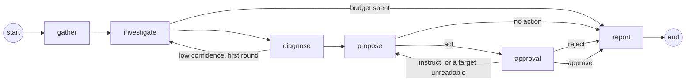

# Graph

How one incident is worked: the LangGraph state, the nodes in order, where the loops go, and how a run survives a restart (`backend/src/bleep/graph/`, `backend/src/bleep/incidents/runner.py`).

## Node order

| Node | Does | Routes on |
|---|---|---|
| `gather` | Collects containers, recent logs, host basics, rules and similar past incidents. No model. | always to `investigate` |
| `investigate` | The model reads with read-only tools, at most 8 tool calls a round; every result reaches it through the guard. | `outcome == "budget"` → `report`, else `diagnose` |
| `diagnose` | A structured `Diagnosis`. | low confidence after the first round → `investigate`, else `propose` |
| `propose` | A `Proposal`: one to three allowlisted steps, or no action, checked in code (`guard/plan_check.py`) before a human sees it. | `act` → `approval`, `no_action` → `report` |
| `approval` | Snapshots the target containers, stores the plan as a pending approval, notifies, and waits for the human (`interrupt()`). | `instruct` or a target it could not read → `propose`, `reject` or `approve` → `report` |
| `report` | Sets the outcome. | end |

Gather, Investigate, Diagnose, Propose, Approval, the topology and the runner are built; Report is still the Milestone 2 stub that only sets the outcome. Execute and Verify come between Approval and Report in Milestone 3; until then an approved plan is reported with the outcome `unverified`, because nothing ran and nothing was checked.

## State

`IncidentState` (`graph/state.py`) is a `TypedDict`; the models it holds are in `schemas/graph.py`.

| Key | Holds | Written by |
|---|---|---|
| `incident_id`, `subject`, `signals` | Which incident, about what, and the signals that opened it | the runner, at start |
| `context` | `GatherContext`: containers, guarded log excerpts, host basics, top memory users (host incidents), host and service rules, similar past incidents, `gaps` | `gather` |
| `messages` | The model conversation (`add_messages` reducer) | `investigate` |
| `investigate_rounds`, `tool_calls_used` | Budget counters | `investigate` |
| `diagnosis` | `Diagnosis(root_cause, category, evidence, confidence, affected_services, unsure)` | `diagnose` |
| `proposal`, `instructions` | `Proposal(kind, steps, reason, verification, human_instructions)`; the human's instructions so far | `propose`, `approval` |
| `approval`, `decision`, `grant` | The approval this run last consumed (`ApprovalRequest(id, plan_hash)`); the human's `Decision`; the `ApprovalGrant` act tools check | `approval` |
| `execution`, `verify_loops`, `verification` | Step results and the verify loop | Milestone 3 |
| `outcome`, `report` | `resolved`, `rejected`, `no_action`, `unverified`, `budget` or `unsure`; the write-up | `report` (or a node that ends the run early) |

## Choices

- **Every Milestone 2 model is defined up front in `schemas/graph.py`.** `StepResult`, `VerificationResult` and `Report` are minimal placeholders for Milestone 3. Reason: the node tasks run side by side and each needs the others' shapes fixed (#16).
- **One module per node, owning its `make(deps)` and its `route(state)`.** `graph/build.py` only wires them and lists each route's possible targets. Reason: a node task changes its own module and nothing else (#16).
- **Dependencies are passed once, as `GraphDeps`.** Registry, tool registry, a model factory (`role → chat model`), memory, bus, approvals, notifier, guard log, settings and the cost ledger. Nodes are closures over it; the state holds only data. Reason: the state is checkpointed, and a connection or a model client does not belong in a checkpoint (#16).
- **Memory, notifier, approvals and settings are Protocols with small defaults.** `NullMemory` recalls nothing, `NullNotifier` sends nothing beyond the bus, `InMemoryApprovals` keeps requests in a dict (tests only; the app's store is `ApprovalStore`, #20), `StaticSettings` serves the default budgets, the env's model settings and the three Docker actions. Reason: the graph runs and is tested before long-term memory, Telegram and the settings store exist (#16).
- **`Approvals.request` takes one `TargetSnapshot` per plan target.** Reason: a plan has up to three steps, and each target must be re-checked before Execute (#16).
- **Gather makes no model call.** It reads through the registry and the engine only; a test fails if the model factory is even asked for a model. Reason: the first look is cheap, repeatable and cannot be steered by the logs it reads (#16).
- **Gather refreshes the host first.** It lists the containers again before reading them. Reason: the incident is about the state now, and the watcher's last poll can be 30 s old (#16).
- **Log excerpts: the last 200 lines of each affected container, through the guard.** Affected means the containers the signals name, or every container of the service when none does (a URL check), at most 5. Each excerpt goes through `guard_text` (redacted, cleaned, capped at 8,000 characters, wrapped as `<untrusted>`), and redactions are recorded in the guard log. Reason: logs are the main way hostile text reaches the model, so they enter the state already safe to put in a prompt (#16).
- **A host incident gets the top 5 containers by memory.** `docker stats` on the running containers, at most 8 at once. Reason: when a host runs out of memory the first question is who is using it (#16).
- **Basics come from the registry, not a new SSH read.** Reason: the registry reads them at most every 60 s already; a second read would double the SSH traffic for no new information (#16).
- **What Gather cannot read becomes a line in `gaps`, never an error.** An unreachable host, a vanished service or a failed recall each add one fixed, short line ("logs of shop-web-1: host unreachable"); engine error text is not copied in. Reason: the run must go on with what it has, and Bleep's own lines must not carry host text (#16).
- **Similar incidents are asked for with `"<service or host>: <signal kinds>"` and the service id, top 3.** Reason: what failed and where is the useful similarity at the start of an incident, and the id lets memory rank the same service first (#16).
- **Every node publishes `node_started` and `node_finished` with `{"node": name}`.** A wrapper in `build.py` does it, so no node can forget. Reason: these events are the live reasoning view (#16).
- **A node that calls `interrupt()` runs again from its first line on resume.** It publishes `node_started` again and no `node_finished` before the pause, and anything it does before `interrupt()` must be safe to repeat. Reason: that is how LangGraph resumes; the approval node is the one this matters for (#16).
- **Checkpoints go to `checkpoints.sqlite` through `AsyncSqliteSaver`, one thread per incident (`thread_id` = incident id).** `open_checkpointer(path)` opens it for the app's lifetime. Reason: a run can wait hours for a human and must outlive a restart (#16).
- **The checkpoint serializer may rebuild only the state's own models.** `checkpoint_types()` walks `IncidentState` for every pydantic model, nested ones included, and passes them to LangGraph's `allowed_msgpack_modules`. Reason: without the list LangGraph rebuilds any class a checkpoint row names, and already warns that it will stop doing so (#16).
- **The runner runs each incident in a background task.** `start(incident)` and `resume(incident_id, decision)` return at once; one incident never runs twice at the same time, and a second `start` while one is in flight returns that run. Reason: the watcher and the Telegram poller must not wait for a model (#16).
- **`start` goes on from wherever the thread stands.** No checkpoint: a new run from Gather with the incident's signals. A checkpoint mid-graph: on from it. Waiting at approval or finished: left as it is. Reason: starting an incident twice, or after a restart, must never repeat work (#16).
- **`recover_on_boot` restarts every unfinished incident except those `awaiting_approval`.** Reason: those are waiting for a human, and their checkpoint holds them until a decision arrives (#16).
- **A decision recorded before a crash is delivered on boot.** When the thread is still at the interrupt but the incident's latest approval is decided (Bleep died after `resolve` and before the resumed run reached a checkpoint, whether the status still says `awaiting_approval` or already `investigating`), the runner resumes it with the stored decision. It reads the store through the `approvals` it is built with. Reason: otherwise the human's answer is lost and the incident waits forever for a question already answered (#20).
- **A decision for a run that is not waiting changes nothing.** It is logged and dropped. Reason: a late or duplicate decision must not restart or fail a finished run (#16).
- **The runner keeps the incident's status in step.** `investigating` while a run is in flight (also after a decision, so a crash then is recovered), `awaiting_approval` at the interrupt, `resolved` when the outcome is `resolved`, else `closed`. A node that raises marks the incident `failed` and publishes a `notice` naming the error type. Reason: the status is what the dashboard and the boot recovery read (#16).
- **Diagnose is one structured model call, no tools.** It reads Gather's context and the investigation messages and returns a `Diagnosis` through `invoke_structured`, so a model without tool support still answers (#18).
- **Low confidence means `unsure`, and the route reads that flag.** `Diagnosis.unsure` is set when confidence is below the budget's `low_confidence` (0.6 by default, read from settings when the node runs). The first unsure diagnosis, at `investigate_rounds == 1`, goes back to Investigate once; a second one goes on to Propose still unsure, so the proposal can say "I am not sure, here is what I found". Reason: the route has only the state, and the threshold is a setting (#18).
- **The model says what is missing, and that becomes the next round's instruction.** The model fills a private `missing` field next to the diagnosis (not stored on it); Diagnose appends it as a message ("Missing: ...") so Investigate looks for exactly that. Reason: a second round without a target repeats the first (#18).
- **Evidence entries are cut to 300 characters, at most 8.** The prompt asks for statements, and the code truncates what overruns. Reason: weak models paste log lines, and a diagnosis is shown to the human and stored in memory (#18).
- **No diagnosis is a diagnosis, not an error.** Unparseable output (after `invoke_structured`'s retry) or a spent token or cost budget gives `category="unknown"`, `unsure=True`, "I could not form a diagnosis", with the stopped containers and gaps from Gather as evidence. A failed structured reply also gets the one re-investigation, like any low-confidence result. Reason: a weak local model must degrade, not crash the run (#18).
- **Propose asks for a whole plan in one structured answer.** One to three ordered steps or `no_action`, a reason and a verification plan (containers and URLs), through `invoke_structured`, so a model without tool calls answers in plain JSON. Reason: the human approves the plan as a whole, and a weak local model must still be able to answer (#19).
- **Propose's prompt carries Bleep's own facts, not the logs.** The diagnosis with its evidence, the service's containers, the off-limits list (protected and Bleep's own containers), the host and service rules, the service's health URLs, the actions enabled right now, every instruction the human has given and the previous plan (`prompts/graph/propose.md`). Reason: the diagnosis already carries the evidence; keeping raw host text out of the step that writes the plan narrows what an injected log line can steer, and naming the off-limits containers spares a refusal round (#19).
- **The enabled actions are read from `settings_store` each time Propose runs.** Reason: turning a plugin off must stop its actions on the next plan, not after a restart (#19).
- **A plan the code refuses goes back to the model once; refused again, it becomes `no_action`.** The model sees each violation's text (`prompts/graph/propose_retry.md`); after a second refusal the human gets the reasons, the refused steps and the model's reason in `human_instructions`, and nothing goes to approval. Reason: a model often fixes a plan once it can read why it was refused, and one that does not should not get a third try at a guarded action (#19).
- **An unsure diagnosis gets `no_action` without a model call.** Reason: Bleep does not propose an action for a cause it says it does not know; the human gets what it found instead (#19).
- **Propose degrades instead of failing.** No usable structured answer gives `no_action`; a spent token budget or daily cap gives `no_action` with the outcome `budget`, checked before each of its (at most two) model calls. Reason: an incident must always end with a report, never a crashed run (#19).
- **The final proposal is published as a `proposal` event.** Reason: the live view shows the plan, or why there is none, as soon as it exists (#19).
- **Investigate runs its model ↔ tools loop inside one node.** It asks the model, runs the calls it makes, hands back the results and asks again, and stops when the model answers without a tool call, after 8 tool calls this round (`Budgets.investigate_tool_calls`), or when a budget is spent. Reason: the topology stays the one `build.py` already wires, and one node owns the whole budget (#17).
- **The tool-call cap ends the round, not the run.** The run goes on to Diagnose with what was found. Calls past the cap in the same reply are answered `not run: the tool-call budget for this round is spent`, because a conversation with an unanswered tool call is refused by the next model call. `tool_calls_used` counts every round together. Reason: eight reads are normally enough to diagnose, and stopping there is cheaper than failing the incident (#17).
- **A spent cost budget stops before the model call.** `check_budget` runs before every call; on `BudgetExceeded` the node sets `outcome = "budget"`, publishes a `notice` naming the daily cap or the incident's token budget, tells the notifier and records `budget` in the guard log, and the route goes to Report. Reason: a daily cap of $0 must mean no model call at all (#17).
- **Every tool result is guarded again in the node, and wrapped exactly once.** A result that is one wrapper already (the Docker and host tools guard their own output) is cleaned and redacted again and rewrapped under the tool's name, without a second cut, so the `[… N chars cut]` count stays true. Anything else (a tool's own short text, `host unreachable: <wrapped error>`, a future tool that does not guard) goes through `guard_text` whole, with any wrapper inside taken off first; output over 32,000 characters skips that step and any wrapper in it is escaped as data, so a hostile result cannot make the pattern scan it many times. Reason: the model never sees a result that skipped the guard, whoever wrote the tool, and never sees a wrapper inside a wrapper (#17).
- **A refusal or a failure is text for the model.** `CommandNotAllowed` comes back as the refusal and is recorded as `refused_command`; any other exception comes back as `the tool failed (<type>)` without its message; an act tool's name is answered as not available and recorded as `blocked_action`; an unknown name is answered `there is no tool named …`. Reason: the model can correct a call it can read about, and one bad call must not end the investigation (#17).
- **Tool calls and results stream to the bus.** `tool_call {name, args}` before the call, `tool_result {name, chars, summary_first_line}` after it, where `chars` is the length the model gets and `summary_first_line` the first non-empty line inside the wrapper (at most 160 characters, already redacted). Reason: the live view shows what the agent is looking at without copying whole logs into the timeline (#17).
- **The first round opens the conversation with `prompts/graph/system.md` and `prompts/graph/investigate.md`.** The system prompt says host text arrives as `<untrusted>`, that only the closing tag with the same id ends it, and that host and service rules apply to every conclusion. The task message carries the subject, the signals and the containers (both wrapped, since signal details and image names come from the host), Gather's log excerpts as they are, the host's basics and top memory users, the rules, similar past incidents, the gaps and the budget. Reason: the system prompt is shared by the nodes that come after, and only Bleep's own text sits outside a wrapper (#17).
- **A second round continues the same conversation.** When Diagnose sends the run back, Investigate adds `prompts/graph/investigate_again.md` with the low-confidence diagnosis, unless the last message is already a human one (Diagnose said what to look for). Reason: the model keeps what it read in the first round, and the second round is about what was missing (#17).

## Approval

`graph/nodes/approval.py`, `incidents/approvals.py` (`ApprovalStore`), `incidents/reminders.py` (`ReminderLoop`), table `approvals` (migration 0006).

- **The first decision wins, enforced by one statement.** `resolve` is a single `UPDATE approvals ... WHERE incident_id = ? AND status = 'pending'`; the caller whose update changed a row won, every other gets None. A partial unique index allows one pending approval per incident. Reason: Telegram and the dashboard can answer at the same moment, and a read-then-write check loses that race. `resolve` also takes the `approval_id` the decision was made for and adds `AND id = ?`, so a late button tap on a replaced plan wins nothing; the node passes its own approval's id, and the channels (#21, #22) pass the id from the button or callback (#20).
- **The plan hash covers the steps and the container ids their targets resolved to.** `plan_hash(proposal, snapshots)` is sha256 over the canonical JSON (sorted keys, no spaces) of each step plus its `container_id` (`null` for a step whose target is not a container). The reason text and the verification plan are not part of it. Reason: a container recreated under the same name is a different target, so an approval for the old one must not cover it (#20).
- **The grant is `HMAC-SHA256(BLEEP_SECRET, incident_id + plan_hash)`, issued only by the store and only for a plan it holds as approved.** The node asks `approvals.grant(incident_id)` after an approve; a reject, an instruction or a pending approval gets none. Reason: an act tool can check the grant without the database, and nothing but a recorded yes can mint one (#20).
- **Each Docker target is snapshotted when the question is asked.** `TargetSnapshot(host_id, target, container_id, started_at)`, read with a fresh `inspect`, one per distinct target, stored with the approval for Execute to compare against. `created` stays empty: the engine's summary does not carry it, and a recreated container already shows as a new id. Reason: Execute must refuse to act on a container that changed since the human said yes (#20).
- **A target that cannot be read sends the run back to Propose instead of asking.** The node publishes a `notice` naming the target and a fixed reason ("container not found", "host unreachable") and stores nothing. Reason: a question about a container that is not there cannot be answered usefully, and Execute would refuse it anyway; LangGraph's recursion limit ends a run that keeps proposing it (#20).
- **The question is asked once per round, even though the node reruns on resume.** The node asks only when the incident's latest approval is the one in `state["approval"]` (already consumed by an earlier round) or there is none; otherwise the latest approval is this round's, asked before a resume or a restart, and is reused without a second `approval_requested` or message. Reason: a node that interrupts runs again from its first line, and a second pending row or a duplicate message would confuse the human (#20).
- **The stored decision is the one that counts.** If the latest approval is already decided when the node runs, it uses that decision and does not interrupt; a value resumed into `interrupt()` is first passed to `resolve`, and if it loses, the winner's decision is used. A notifier that raises does not fail the node: the question is already stored and on the bus, so it logs, publishes a `notice` and still interrupts, and the reminder loop re-sends. Reason: a late or stray resume can never override what the human actually chose first (#20).
- **The node publishes `approval_requested` (`approval_id`, `plan_hash`) and `decision` (`kind`, `text`, `via`), and calls `Notifier.proposal`.** Reason: the bus is the dashboard's timeline; the notifier carries the question to Telegram (#20).
- **An instruction appends its text to `instructions` and goes back to Propose**; a reject goes to Report with the outcome `rejected`; a `no_action` proposal never reaches Approval (Propose routes it to Report). Reason: §4.4 step 5 (#20).
- **Reminders re-send a pending approval every `approval_reminder_min` minutes (60) and never decide it.** The n-th reminder is due n periods after the request; the count is stored, so after downtime one reminder goes out, not one per missed period, and it is counted before it is sent (a crash loses a reminder rather than repeating one). Only approvals of open incidents are reminded. The period is read from the settings at every tick. Reason: a plan can wait days for an answer, and Bleep must never act without an explicit yes (§2, §4.4) (#20).
